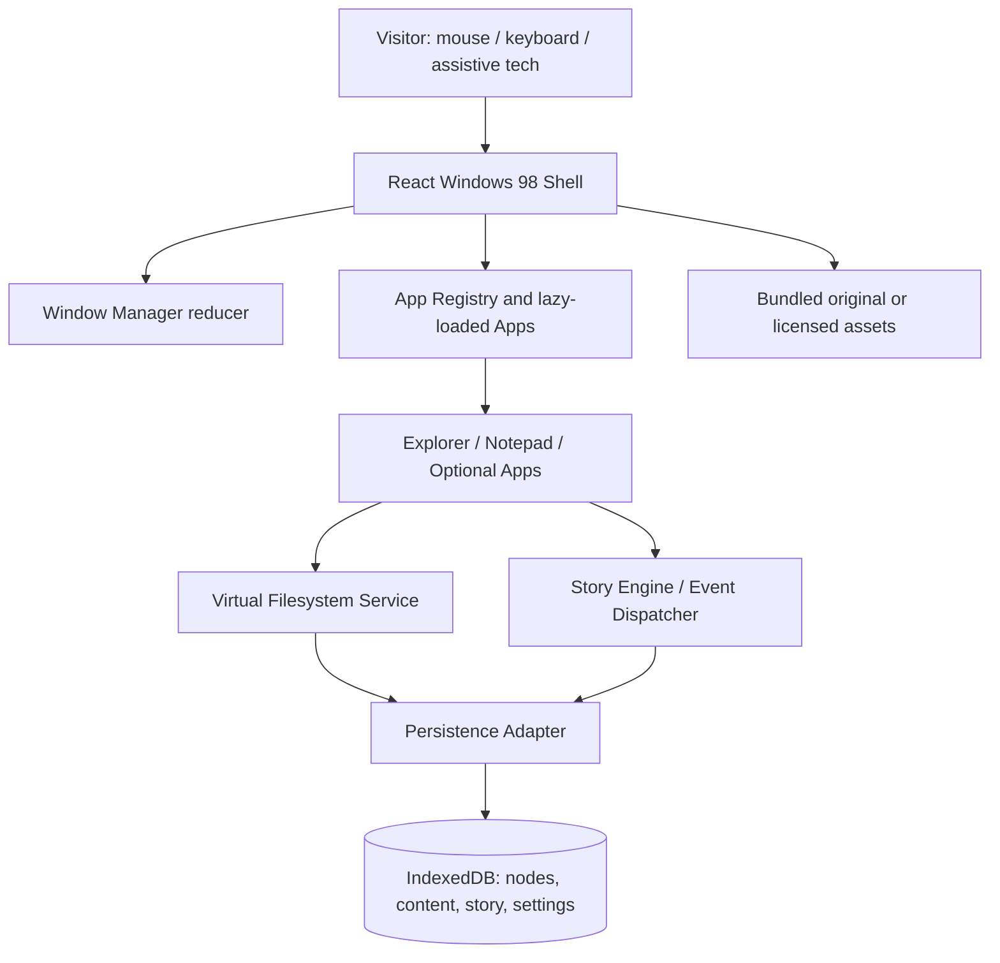
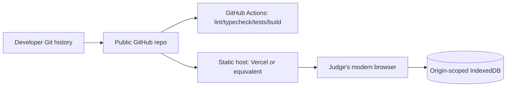
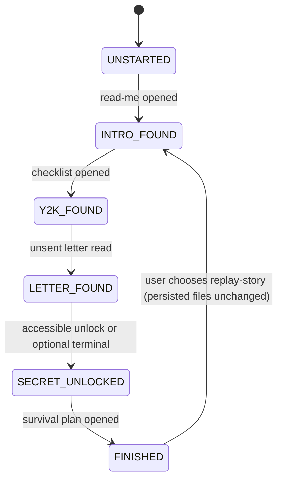

# Executive briefing

**Purpose.** This is a comprehensive, implementation-oriented *proposal* for a browser-based Windows 98-inspired computer experience, based on the seven-page Gandhi Hackathon PDF supplied by the user. It documents what to build, how to build it, how to verify it and how to submit it. It is **not** an implemented application, a proven test report or organizer-issued technical specification.

**Organizer's actual priorities.** The official challenge describes a Windows 98 look/feel/experience and emphasizes humorous Easter eggs and entertaining presentation, creativity, functionality, visual authenticity and cleanliness. The organizer additionally requires **a public GitHub repository with intact commit history** and **a working live browser URL** (PDF p.6). The individual apps/media shown on pp.3–5 are options, not mandatory requirements. The user's additional engineering criteria are quality targets, not the official scoring list.

**Recommended MVP.** Browser boot → retro desktop & taskbar → reliable multi-window manager → Explorer and Notepad → browser-persistent seeded filesystem → 1999 Y2K clue path → skippable comedic reveal. Build and deploy this vertical slice before optional DOS, browser, Paint or games.

**Suggested technology.** React + TypeScript + Vite + 98.css + IndexedDB; tests with Vitest and Playwright. A static website suffices; do not execute real shell commands or embed arbitrary websites inside fake Internet Explorer.

**Contents.** The following chapters are organised for copy into a GitHub `docs/` folder. TypeScript types, sample fixture JSON, CI YAML and submission templates are separately packaged in the ZIP. The original hackathon PDF is referenced rather than duplicated.

---

# Repository documentation index

# THE LAST LOGIN — Windows 98 Mystery Experience

**Gandhi Hackathon 2026 | Engineering & Product Documentation Pack**  
**Document status:** proposed solution blueprint; not a completed implementation  
**Source brief:** `Gandhi_Hackathon_PS.pdf`, 7 pages, dated 1 November 2026.  
**Recommended delivery:** browser-based, public static deployment plus a public GitHub repository.

## Read this first

The challenge requires a convincing interactive Windows 98-style computer experience. The official PDF explicitly prioritizes humorous/entertaining Easter eggs, then creativity, functionality, visual authenticity, and cleanliness (p.6); the submission must have **both** a public GitHub repository with full commit history and a working public URL (p.6). The lists of applications, period websites, games, files, and secret discoveries on p.3–5 are **ideas, not mandatory requirements**. Page 7 emphasizes making the computer feel as if it belonged to a real person.

**Important distinction:** The project name, Y2K story, React technology stack, internal interfaces, performance budgets, and development phases in this pack are our **design proposals**, not rules issued by the organizers. The user's additional criteria—code quality, security, efficiency, testing, accessibility, alignment, innovation—are engineering assurance targets; they are **not stated as the official rubric in the PDF**.

## Proposed product in one sentence

A visitor boots a believable Windows 98 desktop, opens functioning applications and a persistent virtual filesystem, discovers clues about its owner, and unlocks an intentionally funny Y2K-themed reveal.

## Recommended order of use

1. `01-BRIEF-AND-SCOPE.md` — official requirements vs choices and exclusions.
2. `02-PRD.md`, `03-FUNCTIONAL-REQUIREMENTS.md`, `04-NONFUNCTIONAL-REQUIREMENTS.md` — what to build and what counts as done.
3. `05-ARCHITECTURE.md`, `06-DESIGN-SYSTEM-AND-UX.md`, `07-WINDOW-MANAGER.md`, `08-VIRTUAL-FILESYSTEM.md` — system design.
4. `09-APPLICATION-SPECIFICATIONS.md`, `10-STORY-AND-CONTENT.md` — core experience.
5. `11-SECURITY-THREAT-MODEL.md`, `12-ACCESSIBILITY.md`, `13-PERFORMANCE.md`, `14-TEST-PLAN.md` — verification.
6. `15-IMPLEMENTATION-GUIDE.md`, `16-BACKLOG-AND-MILESTONES.md`, `17-CI-CD-DEPLOYMENT.md` — build and publish.
7. `18-RISKS-AND-IP.md`, `19-DEMO-AND-SUBMISSION.md`, `20-ARCHITECTURE-DECISIONS.md`, `21-TRACEABILITY-MATRIX.md`, `22-SOURCE-REFERENCES.md`, `23-INTERFACES-AND-ALGORITHMS.md`, `24-TROUBLESHOOTING.md` — delivery governance, contracts and support.
8. `contracts/`, `fixtures/`, `templates/` — ready-to-adapt examples; **not** a working application.

## Delivery definition

**P0 (required for our chosen MVP):** boot flow; desktop; Start menu/taskbar; focusable movable/minimizable windows; file Explorer; Notepad save/reopen; IndexedDB persistence; one complete story path; reliable live deployment; public GitHub.  
**P1:** calculator, safe fake browser, terminal, Recycle Bin, accessibility enhancements, extra story details.  
**P2:** Paint, one game, dial-up effects, Control Panel. Only implement P2 after P0 meets its acceptance gates.

## Suggested repository

```text
the-last-login/
├── src/                  # real app source after implementation
├── public/               # licensed/original assets
├── docs/                 # copy markdown files from this pack
├── e2e/                  # Playwright tests
├── contracts/            # optional copy of TypeScript reference interfaces
├── .github/workflows/    # CI
├── README.md             # public project entry point
├── package.json
└── package-lock.json
```

## Start building

```bash
npm create vite@latest the-last-login -- --template react-ts
cd the-last-login
npm install
npm install 98.css idb
npm install -D vitest @playwright/test @axe-core/playwright
npm init playwright@latest
```

Check the Node requirement on the current Vite documentation; as checked in November 2026, it lists Node 20.19+ or 22.12+ (or compatible later releases). `npm init playwright@latest` may create tests/configuration and prompt for browser installs. Configure scripts and CI as described in `15-IMPLEMENTATION-GUIDE.md` and `17-CI-CD-DEPLOYMENT.md`.

## Document-change protocol

Any change to a P0 feature must update: (a) relevant requirements and ID, (b) module contract, (c) tests/acceptance, and (d) the README demo path if affected. Do not claim a checklist item passed until actually tested. All budgets/targets are proposals until measured.


---

# 01 — Brief, Source Alignment, Scope

## A. Official source extraction

| PDF location | What it says | Consequence |
|---|---|---|
| p.2, The Premise | Recreate the *look, feel and experience* of an abandoned Windows 98 machine as a website or desktop app | Browser delivery is permitted; functional desktop illusion is essential |
| p.3, What You Can Build | Desktop, applications, period internet, files/folders, hidden discoveries; options, not requirements | Choose strategically, don't blindly implement all examples |
| p.4–5, Ideas | Historical files, old websites, classic games, personal photographs | Period-specific texture, but check authenticity, chronology and rights |
| p.6, Judging | First and most important: funny/entertaining Easter eggs; then creativity, functionality, visual authenticity, cleanliness | Prioritise one strong reveal and working interactions over feature count |
| p.6, Submission | Public GitHub repository, **full commit history intact**, and live browser URL | Must publish code and deploy; recording/localhost is not enough |
| p.7, Objective | Make visitor *feel* they found and started using an abandoned computer | Content coherence and narrative are core product properties |

The user's separate desired quality criteria are code quality, security, efficiency, testing, accessibility, problem alignment, and innovation. They are complementary quality goals, **not verbatim PDF judging criteria**.

## B. Solution definition (proposed)

- **Product name:** The Last Login.
- **Format:** React/TypeScript single-page application hosted over HTTPS.
- **Premise:** An abandoned Windows 98 PC contains records of a home user's elaborate but mistaken Y2K disaster plan. Clues are embedded in normal-looking documents and app interactions. The final discovery creates a harmless fake system meltdown and a funny payoff.
- **Setting:** User's files mostly dated 1998–31 Dec 1999; the owner stops using the PC around New Year 2000. The visitor arrives later. Avoid 2001 documents unless story dates are explicitly changed.
- **No account/backend:** Visitors explore a local simulated environment. Progress persists in their browser. This is not real OS emulation or a general-purpose shell.

## C. In scope

1. Period-styled boot screen, desktop, Start menu, taskbar, wallpaper, icons, title bars and window controls.
2. Multiwindow open/focus/move/minimize/maximize/close interactions, taskbar switching and keyboard alternatives.
3. Virtual `C:\` drive with read/write text content, folders, delete/restore, seeded files and persistent state.
4. Explorer and Notepad; one complete and tested story arc with at least three discoveries and one comedic reveal. The P0 path must not depend on optional fake IE or terminal.
5. Supporting optional simulated programs, dependent on remaining capacity.
6. Screen-reader labels, keyboard support, reduced motion, accessible alternative to drag/double-click.
7. CI build/tests, public repository, live URL, README and asset/attribution register.

## D. Explicitly out of scope for first release

- Booting a genuine Windows 98 operating system image, BIOS emulation, hardware drivers or actual `.exe` execution.
- Connecting to arbitrary live third-party websites inside a 1990s browser frame.
- Executing real DOS/shell commands; access to a visitor's OS files.
- Authentication, cloud accounts, multiuser file sync, multiplayer games or paid hosting features.
- Commercial game ROMs, unlicensed songs/screenshots, private real-person photos, or original copyrighted Windows binaries.
- P0 mobile-first parity: support a readable narrow-screen fallback, but optimize desktop interaction.

## E. Key assumptions that must be confirmed during building

- One team can implement the MVP and publish it; team size and hackathon deadline **not provided** in the PDF.
- Judges will use a modern browser, internet connection, mouse/keyboard. Verify on Chrome/Edge and Firefox; Safari if accessible.
- Audio is optional, muted by default until user action; do not depend on auto-play.
- All story content and assets are original or permissioned.

## F. Scope controls

**Must never cut:** stable startup + desktop, working window manager, Explorer/Notepad file state, coherent discovery, funny ending, live URL and GitHub history.  
**First to cut:** Paint, Solitaire, custom animation, extra environments, extensive Control Panel, real-time multiplayer.  
**Change control:** Any new feature must identify user value, test criteria, engineering effort/dependencies and the P0 risk it introduces.

## G. Acceptance definition (product-level)

The application is acceptable when a judge can open the deployed URL in a fresh private browsing window; boot; use the Start menu; open Explorer; find a clue; use Notepad to save and reload a file; trigger a story milestone and a funny reveal; refresh and retain the expected progress; and open the GitHub repository with history. Critical console errors, inescapable pop-ups, inaccessible controls, or dead links are blockers.


---

# 02 — Product Requirements Document (PRD)

## Product thesis

The computer is the protagonist: files, apps and unexpected behaviours tell a coherent story. Features should feel like ordinary desktop utilities, not like a modern game UI pasted onto old chrome.

## Audiences

| Persona | Motivation | Need | Failure mode |
|---|---|---|---|
| Judge / first-time visitor | Be entertained quickly | Clear entry, discoverable novelty, rapid payoff | Stuck in unexplained puzzle or broken UI |
| Nostalgic visitor | Explore a familiar computer | Accurate visual and interaction details | Decorative icons with no behaviour |
| Accessibility-dependent visitor | Navigate without precise mouse action or sound | Keyboard equivalents, readable labels, no timed-only clues | Drag-only interactions, tiny controls, silent clues |
| Developer/judge inspecting repo | Evaluate engineering | Modular code, tests, licence register, reproducible build | Unstructured source, broken scripts, missing README |

## Main user journey

1. Land on startup screen with **Start Computer** or accessible equivalent. Optional boot sound after interaction.
2. Arrive at classic teal desktop with icons `My Computer`, `My Documents`, `Recycle Bin`, `Internet Explorer`, `Notepad`, and `Read Me First`.
3. Use mouse or keyboard to open a file in Explorer. Notepad shows a note from the previous owner.
4. Find an unsent letter in Explorer (or via an optional browser mailbox), then discover an odd hidden folder.
5. Decode an accessible clue with a simulated terminal/help option.
6. Trigger harmless Y2K meltdown joke and the ending. Display a **Replay mystery** option without erasing Notepad user changes unless explicitly confirmed.
7. Revisit applications and explore optional Easter eggs.

## User stories

- **US-01:** As a visitor, I can start the PC and reach an interactive desktop so I understand the environment.
- **US-02:** I can use Start menu and desktop icons to launch apps, with one consistent windowing model.
- **US-03:** I can switch, move, maximize, minimize, close and restore windows so the PC feels functional.
- **US-04:** I can navigate folders and open their files so discoveries feel earned.
- **US-05:** I can create, edit, save, and reopen text so apps have genuine state.
- **US-06:** I can refresh without losing progress, within browser storage limits.
- **US-07:** I can uncover sequential clues and receive a clear ending.
- **US-08:** I can navigate by keyboard, without requiring drag or audio.
- **US-09:** I can choose to reset story progress and/or filesystem with clear confirmation.
- **US-10:** As a reviewer, I can access a public demo and public repo with instructions and test commands.

## Product feature decisions

| Feature | Level | Done when |
|---|---|---|
| Desktop, taskbar, Start menu, boot | P0 | App icons open target windows; menus close reliably |
| Window manager | P0 | Full lifecycle, stacking/focus and taskbar switching work |
| Explorer | P0 | Navigate folders via virtual filesystem, open text files |
| Notepad | P0 | Edit, Save, Save As, reopen; unsaved changes prompt |
| Seeded story data + progress | P0 | Discover, unlock, persist, replay; clues aren't dead ends |
| Live deploy/repo | P0 | Judge can access both in private window |
| Recycle Bin / Calculator / terminal / fake IE | P1 | Meaningful behaviour; no fake buttons |
| Optional accessibility controls | P1 (core keyboard is P0) | Font scale, reduced motion, contrast option persist |
| Paint / game / dial-up | P2 | Entire scoped feature tested end-to-end |

## Experience principles

- **Authentic, not inaccessible:** recognizable Windows 98 shape and sound, modern keyboard handling.
- **Functional, not merely visual:** each P0 app must accomplish its stated task.
- **Discoverable, not obscure:** hidden details may be surprising; primary progression must have a clue or hint route.
- **Funny, not disruptive:** gag dialogs have dismissal/skip paths; fake crashes never lose state.
- **Era-coherent:** set the owner’s final activity before 1 Jan 2000 unless deliberately re-scoped.
- **Judge-safe:** avoid shocking content, copyrighted songs/games, political propaganda and real-world harmful instructional documents.

## Measures and quality thresholds — proposed, not official

- 100% of P0 acceptance tests pass before submission.
- The key walkthrough takes approximately **3–5 minutes when rehearsed**; measure it instead of assuming.
- Zero known critical/high severity security issues in included runtime dependencies at submission; document unresolved findings.
- Keyboard-only completion of the entire P0 story.
- No story progress lost after typical refresh; when browser storage is blocked, provide non-persistent fallback and notice.
- Zero dead links in the submitted README and production demo.

## Success/failure examples

**Success:** Judge finds `C:\My Documents\y2k_checklist.txt`, opens and edits an unrelated text file, follows clues, triggers a scripted popup, closes it, reaches a finale, and can continue using the desktop.  
**Failure:** Boot takes forever, click icons are decorative, the app traps users in a dialog, reloading clears all state silently, or the source repo is inaccessible.


---

# 03 — Software Requirements Specification: Functional

All IDs in this document are *proposed implementation requirements*, not lines from the PDF. Priority `P0` means MVP mandatory; `P1` and `P2` are optional expansion.

## Desktop shell

| ID | Priority | Requirement | Acceptance evidence |
|---|---|---|---|
| FR-001 | P0 | Startup view can transition to desktop by explicit input | Start PC works with pointer and keyboard |
| FR-002 | P0 | Desktop presents period-styled wallpaper/icons/taskbar | Screenshot comparison with design tokens |
| FR-003 | P0 | Double-click desktop icons opens associated applications | App registry resolves icon action |
| FR-004 | P0 | Alternative single-click/open-by-keyboard exists | Enter/Space opens focused icon |
| FR-005 | P0 | Start menu lists functional applications | All P0 menu items open usable apps |
| FR-006 | P0 | Start menu closes with Escape, outside click, or app activation | E2E checks for each case |
| FR-007 | P0 | Clock displays a coherent period/story time or clear modern clock mode | No unexplained date contradiction |
| FR-008 | P1 | Restart resets ephemeral shell state without deleting persisted files | Refresh/restart distinguishes shell and saved state |

## Window manager

| ID | Priority | Requirement | Acceptance evidence |
|---|---|---|---|
| FR-010 | P0 | Open by app ID, with unique window-instance ID | Multiple appropriate app windows supported |
| FR-011 | P0 | Focus window raises it above others | Click changes active title bar and z-order |
| FR-012 | P0 | Move window through title-bar interaction | Position clamped to usable viewport |
| FR-013 | P0 | Minimize removes window from visible desktop and exposes taskbar entry | Restore returns prior state |
| FR-014 | P0 | Maximize/restore preserves prior bounds | Restore uses saved normal bounds |
| FR-015 | P0 | Close destroys instance, not persisted content | Notepad unsaved guard prevents silent loss |
| FR-016 | P0 | Taskbar buttons activate/minimize/restore windows correctly | E2E interaction flow |
| FR-017 | P0 | Keyboard alternatives exist for move and close | Escape/Alt-F4 equivalent and Move controls documented |
| FR-018 | P0 | No window becomes unreachable due to resizing/off-screen coordinates | Clamp and viewport resize test |

## Virtual filesystem and persistence

| ID | Priority | Requirement | Acceptance evidence |
|---|---|---|---|
| FR-020 | P0 | Seed a virtual `C:\` drive on first visit | Expected default folder tree present |
| FR-021 | P0 | List files by parent and open supported file types | Explorer shows correct entries |
| FR-022 | P0 | Create/update text files using Notepad | Save then reopen preserves content |
| FR-023 | P0 | Persist file tree and story flags using IndexedDB | Page reload preserves updates |
| FR-024 | P0 | Reject invalid names/paths and tree cycles | Path validation tests pass |
| FR-025 | P1 | Create/rename/move/delete folders/files with collision handling | State and UI stay consistent |
| FR-026 | P1 | Recycle Bin supports soft-delete/restore/permanent-delete | Restore returns original or resolved parent |
| FR-027 | P1 | Reset story separately from reset filesystem | Confirmations and scoped reset work |
| FR-028 | P0 | Handle storage unavailability with an explicit notice and safe fallback | Simulated quota/private-mode failure test |

## Applications

| ID | Priority | Requirement | Acceptance evidence |
|---|---|---|---|
| FR-030 | P0 | Explorer supports directory navigation and file open | Bread crumbs/Back/Up work |
| FR-031 | P0 | Notepad supports editable text and Save/Save As | File remains stored after refresh |
| FR-032 | P0 | Notepad tracks dirty changes and warns on close | Cancel close leaves unsaved content |
| FR-033 | P1 | Calculator supports basic arithmetic and error states | Unit tests: zero, decimals, negative, divide by zero |
| FR-034 | P1 | Fake IE routes to bundled period-style pages without arbitrary web execution | Addresses map only to registered local content |
| FR-035 | P1 | Simulated terminal supports an allowlist of commands | Unknown input returns safe error; no eval |
| FR-036 | P2 | Paint/game has complete limited functionality | Dedicated acceptance test suite |

## Story and presentation

| ID | Priority | Requirement | Acceptance evidence |
|---|---|---|---|
| FR-040 | P0 | Story milestone IDs are idempotent and persist | Reopening clue does not corrupt progression |
| FR-041 | P0 | At least 3 discoverable clues lead to one coherent ending | New-user walkthrough succeeds |
| FR-042 | P0 | A deliberate humorous Easter egg exists in normal exploration | Judge can trigger a repeatable reveal |
| FR-043 | P0 | Story can be completed without requiring sound or time-sensitive input | Keyboard/silent-mode walkthrough |
| FR-044 | P0 | Final fake failure is safely dismissible and does not delete saved state | Close/reopen confirms persistence |
| FR-045 | P1 | Optional clues/hints prevent deadlock | Hint appears after explicit request |
| FR-046 | P1 | Replay mystery without wiping personal notes | Scoped replay choice |

## Deployment and review

| ID | Priority | Requirement | Acceptance evidence |
|---|---|---|---|
| FR-050 | P0 | Public production URL loads boot and assets over HTTPS | Private window / independent network check |
| FR-051 | P0 | Public GitHub repo exposes source and original commit history | Repository branch/history accessible |
| FR-052 | P0 | README explains install/build/test/demo, licence and feature status | Reviewer can reproduce build |
| FR-053 | P0 | Application failures are recoverable rather than blank screens | Error boundary/fallback test |

## Acceptance state invariants

1. At most one topmost focused non-minimized window (`activeWindowId` is null only when appropriate).
2. Every taskbar entry references an existing window instance; closed windows have no taskbar entry.
3. Every file node (other than drive root) has exactly one valid parent folder; no cycles.
4. Each folder has unique case-insensitive child names (Windows-like semantics).
5. Every new story event is uniquely identified; re-applying an event cannot revert completed milestones.
6. Filesystem updates are persisted before Save success is announced.
7. Reset scope is explicit: `story`, `filesystem`, or `all`.

## Error handling contracts

| Error | UI behaviour | Recovery |
|---|---|---|
| Missing file | Period-styled dialog with path | Back to Explorer; no crash |
| Invalid path/name | In-place validation + alert | Correct input; retain unsaved edits |
| Storage quota blocked | Status warning explaining local changes may not persist | Continue in memory and offer export if implemented |
| Invalid browser address | Fake Internet Explorer 404 page | Back/Home works |
| Unrecognised DOS command | Clear plain-text message | `help` lists allowed commands |
| Missing asset | Local fallback icon/text | App continues functioning |


---

# 04 — Non-Functional Requirements (Quality Gates)

**Status:** recommended engineering targets, not organizer-issued thresholds. Record measured actuals in the submission checklist.

| ID | Attribute | Target/constraint | Verification |
|---|---|---|---|
| NFR-01 | Reliability | No known P0 crash or dead-end; recoverable error boundary | Full demo path repeated in clean and returning sessions |
| NFR-02 | Consistency | Same taskbar/window rules across all apps | App lifecycle integration tests |
| NFR-03 | Persistence | Save completion means committed IndexedDB write | Reload test and forced failed transaction |
| NFR-04 | Security | No real shell execution, remote arbitrary HTML, or OS file access | Static review and adversarial inputs |
| NFR-05 | Security | Untrusted text rendered as text; path/url allowlists | Injection/path traversal tests |
| NFR-06 | Dependency hygiene | No known unmitigated critical/high runtime dependency advisory at submission | `npm audit --omit=dev`, advisories triaged |
| NFR-07 | Accessibility | WCAG 2.2 AA target for core journey; alternative to dragging and double-click | Manual keyboard + axe scan + screen-reader spot check |
| NFR-08 | Responsiveness | Primary desktop UX at 1280×720; narrow width supports basic scroll/reflow and warnings | Browser viewport tests 1280×720, 1024×768, 390×844 |
| NFR-09 | Performance | Aim LCP <= 2.5s under a named test profile; report actual, not assumed | Lighthouse/devtools fixed environment |
| NFR-10 | UI latency | Aim p95 input-to-visible-feedback <= 100ms on development target for simple actions | Profiling repeated representative actions |
| NFR-11 | Animation | No non-optional flashing; respect `prefers-reduced-motion` | CSS/functional audit |
| NFR-12 | Compatibility | Latest stable Chromium and Firefox; WebKit if resources permit | Playwright multi-browser smoke |
| NFR-13 | Maintainability | Strict TypeScript, lint and module boundaries | CI `tsc`, ESLint, review |
| NFR-14 | Testability | Critical pure logic has deterministic tests; P0 journey E2E | Tests run locally and in CI |
| NFR-15 | Privacy | No user analytics, credentials, cloud upload by default; local-only state | Network inspection, privacy note |
| NFR-16 | Durability | Browser storage may be evicted; app must explain limitations | Storage warning and reset/export documentation |
| NFR-17 | Licence compliance | All shipped media have provenance and redistribution rights | `ASSET-LICENSES.csv` completed |
| NFR-18 | Deployment | Site and repository public, with documented rollback | Fresh-browser live smoke and previous deployment |

## Performance measurement protocol

Document date, device/CPU, browser version, viewport, simulated network, cache state, deployment hash, tool version and run count. Run at least three trials for key measures. Do not market a target as an achieved value.

## Reliability under partial failure

- If IndexedDB is unavailable, boot with in-memory seed, display a **session-only** warning, and suppress misleading 'saved permanently' messages.
- If any optional app fails to import, show a recoverable app-specific error dialog, not a blank desktop.
- If audio is blocked, continue silently. The story cannot depend on sound.
- If a large fixture fails to load, use a text-only alternative; don't block core shell.

## Browser compatibility decision

Windows 98 appearance does not require an actual 1998-era browser. The **target browser is modern**; period browsers are simulated applications within the website. That distinction avoids severe modern security problems and deployment complexity.


---

# 05 — High-Level System Architecture

## Core decision

Deliver a **static React/TypeScript application**. All fake OS operations occur in browser memory, and persist through IndexedDB. No application server, SQL database, authentication, external AI model or real command execution is required for MVP.



## Component boundaries

| Component | Responsibility | Must not do |
|---|---|---|
| Shell | Boot/desktop/taskbar/start menu, viewport and accessible focus orchestration | Edit persisted file records directly |
| Window manager | Open/focus/position/minimize/maximize/close state; z-order | Read IndexedDB or story fixtures |
| App registry | `appId` to lazy component and default title/size/icon | Dynamically execute file contents |
| Explorer | List folder and open files via service | Mutate global database tables directly |
| Notepad | Text buffer, dirty flag, Save/Save As | Write unrelated story flags |
| VirtualFS | Validate names/paths, enforce tree invariants, perform file transactions | Render React UI |
| Story engine | Consume semantic events and update milestone state | Depend on mouse interactions or DOM |
| Persistence adapter | DB versioning, transactions, `idb` access, migrations, reset | Define game narrative or UI layout |
| Assets | Static images/sounds/data fixtures | Contact arbitrary external sites |

## Data flow example — Save in Notepad

```mermaid
sequenceDiagram
  participant U as User
  participant N as Notepad
  participant F as VirtualFS
  participant D as IndexedDB
  participant S as StoryEngine
  U->>N: Edit text; click Save
  N->>F: writeText(fileId, text)
  F->>F: Validate, size and revision checks
  F->>D: Atomic transaction: content + metadata
  D-->>F: Transaction committed
  F-->>N: Success + updated revision
  N-->>U: Clear dirty indicator
  N->>S: publish(file.saved, fileId)
  S->>D: Persist any resulting story milestone
```

The story event should be emitted **after** the file save commit; a failed save must not progress the story.

## State ownership

- **Ephemeral UI:** open windows, focus, start menu, pointer drag state — React reducer/store in memory.
- **Persistent filesystem:** folders, files, text contents, deletion metadata, timestamps — IndexedDB.
- **Persistent story:** unlocked clues, processed event IDs, completed ending — IndexedDB.
- **Persistent preferences:** sound, accessibility mode, wallpaper, hint display — IndexedDB.
- **Static configuration:** app registry, seed fixtures, design tokens — bundled modules/assets.

## App launch contract

`AppRegistry` resolves trusted `appId` strings. The application component receives `{windowId, appId, initialFileId?}` and services. Apps may request `openWindow()` but are not permitted to construct executable component code from file content.

## Persistence lifecycle

1. Bootstrap database with `openDB('last-login', 1, {...})`.
2. Check `seedVersion` metadata. Only seed on first visit; never overwrite user changes on normal refresh.
3. Load persisted story and settings, then render desktop; if storage fails, continue session-only and warn.
4. Mutations use explicit read-write transactions; error paths do not imply successful writes.
5. Schema migrations preserve old user content and are tested with seeded v1 fixtures.

## Fault isolation

Wrap each optional app in an error boundary. Shell-level fallback remains functional. File and story services return typed errors (`NOT_FOUND`, `DUPLICATE`, `INVALID_PATH`, `READ_ONLY`, `QUOTA`, `CONFLICT`), not raw database exceptions.

## Deployment topology



The host provides files; it does not store visitor documents or story progress. No external database connection is needed. The IE-style browser only resolves app-owned routes; it is **not** an open iframe proxy.


---

# 06 — UI / UX Specification

## Authenticity baseline

Use the PDF's reference screenshots (p.1–7), plus independent licensed reference material, to reproduce: teal desktop, compact bevelled grey windows, navy active title bars, small icons, taskbar and Start menu. The visual reference is **Windows 98**, not Windows XP's Luna interface or a generic retro-neon theme.

## Proposed design tokens

| Token | Value | Usage |
|---|---|---|
| `--desktop-teal` | `#008080` | Default desktop background |
| `--win-silver` | `#c0c0c0` | Window body/menus/taskbar |
| `--win-navy` | `#000080` | Active title bar left gradient or fallback |
| `--win-blue` | `#1084d0` | Active title bar right gradient or fallback |
| `--win-white` | `#ffffff` | Highlight bevel |
| `--win-shadow` | `#808080` | Shadow bevel |
| `--win-black` | `#000000` | Foreground |
| `--font-ui` | Tahoma, Arial, sans-serif | Interface text (original system-font assets are not required) |

98.css supplies many bezel/button/window styles; customize only what's needed for accurate scaling and interaction. Use its semantic HTML guidance. Avoid mixing multiple retro CSS systems.

## Screens

### BOOT-01 — Startup

- Render startup panel or logo; one explicit `Start Computer` button as modern accessibility fallback.
- Complete within controllable/skippable animation; no audio autoplay dependency.
- Transition to Desktop with focus on heading or first icon, announced appropriately.

### DESK-01 — Desktop

- Taskbar anchored to bottom; Start button at left; task buttons; clock at right.
- Desktop icons in stable grid, with clear labels and visible selection state.
- Right-click desktop context menu optional. No feature depends on it.
- Explain double-click use unobtrusively or allow single-click accessible open.

### START-01 — Start menu

- Escape closes; arrow-key navigation and Enter activation; pointer outside closes.
- Programs menu shows only implemented apps. Disabled placeholders should be clearly labelled and ideally omitted.

### WIN-01 — Generic window

- Title, app icon, minimize/maximize/close controls, active/inactive styles.
- Use accessible dialog/window semantics and meaningful label. See accessibility spec: windows behave as non-modal regions unless explicitly modal.
- Window position clamped so title bar/close control remain reachable.
- Minimized window remains accessible via taskbar.

### EXPL-01 — Explorer

- Path display, Back/Up/Home, main file list, optional navigation tree, status bar.
- Single-click selects; Enter/double-click opens. Folders open recursively; supported text opens Notepad.
- View and sorting are optional. File type and size metadata use consistent formatting.

### NOTE-01 — Notepad

- Plain textarea with title `filename - Notepad`; dirty indicator `*` in title.
- File > New/Open/Save/Save As/Exit; keyboard shortcuts Ctrl+S, Ctrl+O if implemented.
- Unsaved close confirmation with Save/Discard/Cancel.

### STORY-01 — Discovery and ending

- Standard Windows dialog styling for clue messages, not an unrelated modern overlay.
- Provide dismiss and replay paths. No permanent trap or misleading destructive action.
- Non-audio text conveys every clue; minimize animation when requested.

## Interaction mapping

| Interaction | Pointer | Keyboard / alternate |
|---|---|---|
| Open icon | Double-click | Focus + Enter (or context Open action) |
| Start menu | Click | Tab to button, Enter; arrows inside menu |
| Focus window | Click window | Taskbar traversal / window switcher |
| Move window | Drag title | `Move` menu, arrow keys; Escape cancels |
| Maximize | Title button/double-click title | Focus maximize button + Enter |
| Close | X button | Focus close button + Enter; supported shortcut |
| Open file | Double-click | Select + Enter |
| Advance story | Interact with file/app | Same semantic action via keyboard |

## Responsive behavior

Design for desktop first. At <=768 CSS px: constrain all windows to fit viewport width, stack when necessary, expose a notice that desktop screens provide the most authentic experience; never block access or story completion. Avoid dragging as sole means to recover an offscreen window.

## Accessibility vs authenticity tradeoff

Real Windows 98 tiny controls sometimes conflict with WCAG. Preserve visual silhouette but enlarge actual interactive hit areas (ideally >=24×24 CSS pixels or valid spacing exception), provide optional increased text and visible focus. See `12-ACCESSIBILITY.md`.

## Asset workflow

Use original/permissioned wallpaper, icons, sounds and fictional photos; record copyright and licences in `templates/ASSET-LICENSES.csv`. Do not treat the GitHub `98.css` MIT licence as a blanket licence for Microsoft art or third-party media.


---

# 07 — Window Manager Detailed Design

## State model

```typescript
type WindowId = string;
type AppId = 'explorer' | 'notepad' | 'calculator' | 'browser' | 'terminal';
type Rect = { x: number; y: number; width: number; height: number };
type WindowRecord = {
  id: WindowId; appId: AppId; title: string;
  bounds: Rect; restoreBounds?: Rect;
  mode: 'normal' | 'minimized' | 'maximized';
  z: number; fileId?: string;
};
type WindowState = { windows: WindowRecord[]; activeWindowId: WindowId | null };
```

**Window IDs must be instance IDs**, distinct from app IDs; two Notepad windows may coexist. `z` is internal stacking order; normalize/compact periodically to avoid unbounded growth.

## Action contract

| Action | Data | Outcome |
|---|---|---|
| `OPEN` | appId, initial file, initial bounds | New record; focus new window |
| `FOCUS` | windowId | Bring visible window to top, set active |
| `MOVE` | windowId, x, y | Clamp to viewport; persist only ephemeral position |
| `RESIZE` | windowId, width, height | Enforce app min size and viewport constraints |
| `MINIMIZE` | windowId | Mark minimized; activate next visible topmost |
| `RESTORE` | windowId | Restore old normal bounds; focus |
| `MAXIMIZE` | windowId | Save `restoreBounds`, fill usable desktop minus taskbar |
| `CLOSE_REQUESTED` | windowId | Run app dirty guard (command layer) |
| `CLOSE_CONFIRMED` | windowId | Remove record; select next active |
| `VIEWPORT_CHANGED` | viewport | Re-clamp title bars and size bounds |

## Core algorithm

1. `OPEN`: compute centered/cascaded bounds, add record, increment ordering counter, set active.
2. `FOCUS`: if minimized, restore; set `z=max(z)+1`, `activeWindowId=id`.
3. `MINIMIZE`: leave record in taskbar, but remove from visible/window keyboard path; choose topmost non-minimized window or null.
4. `MAXIMIZE`: save normal bounds exactly once; set mode max; derive display bounds from current viewport.
5. `RESTORE`: if maximized return saved bounds; if minimized return mode normal (or prior max mode if separately tracked; implement with a `preMinimizeMode` field).
6. `CLOSE`: only after dirty guard resolves; removing data from UI never deletes files.
7. `VIEWPORT_CHANGED`: constrain width/height and at least keep title bar and close control inside viewport.

## Pointer interaction

- Use Pointer Events and pointer capture if implementing drag; cancel on pointer cancellation, loss of capture, Escape or unmount.
- Don't drag from nested title-bar buttons. Use a dedicated title region hit target.
- Render drag movement through transform or bounded state updates; commit final coordinates on pointer up.
- Pointer movement must never write to IndexedDB.

## Focus and keyboard rules

- A non-modal window is not automatically an ARIA modal dialog; don't set `aria-modal=true` on the whole desktop.
- On opening a window, focus its title or first meaningful control; on closing, restore focus to originating icon/taskbar item when valid.
- Provide taskbar buttons with labels such as `Activate Notepad: y2k_checklist.txt`.
- Implement a keyboard Move mode: focus window system menu > Move; arrow keys shift by 10px (Shift+arrow 1px), Enter confirms, Escape reverts.
- All close controls are actual buttons with accessible names.

## Critical test cases

- Open 3 windows, focus each in different order; exactly one active title bar.
- Minimize active window; focus switches to highest visible window.
- Restore minimized Notepad: content buffer intact.
- Maximize > minimize > restore > unmaximize: original normal rectangle returns.
- Drag outside viewport; title bar remains reachable.
- Resize viewport from 1280×720 to 390×844; no window is permanently inaccessible.
- Unsaved Notepad close: Cancel aborts window close.
- Switch windows entirely by keyboard.


---

# 08 — Virtual Filesystem, Data Schema and Persistence

## Design goals

Represent one **fake Windows `C:\` drive** inside the website. It is not a mirror of the host filesystem; no app path should ever be sent to the visitor's real OS. Folder navigation follows Windows-looking paths, but internal references use immutable IDs. Case-insensitive sibling-name comparisons preserve classic Windows semantics.

## Node schema (suggested)

```typescript
type NodeId = string;
type FsNode = {
  id: NodeId;
  parentId: NodeId | null;
  name: string;                 // Display name, no slash/backslash/controls
  kind: 'drive' | 'folder' | 'file';
  mimeType?: 'text/plain' | 'image/png' | 'image/jpeg' | 'application/octet-stream';
  sizeBytes: number;
  createdAt: string; updatedAt: string;
  revision: number;
  hidden?: boolean;
  deletedAt?: string | null;
  originalParentId?: NodeId | null;
  readOnly?: boolean;
};
type TextContent = { nodeId: NodeId; content: string; encoding: 'utf-8' };
```

Recommended DB name `last-login`, schema v1. IndexedDB object stores:

| Store | Primary key | Indexes | Content |
|---|---|---|---|
| `nodes` | `id` | `parentId`, `deletedAt` | file/folder metadata |
| `contents` | `nodeId` | none | text or Blob payload (size capped) |
| `story` | `key` | none | completed event IDs and milestones |
| `settings` | `key` | none | wallpaper, sound, reduced motion, seedVersion |
| `meta` | `key` | none | schema/seed tracking and migration markers |

An alternative is one store per file type; for MVP the above is sufficient. Do not use path as primary key: renaming a parent would otherwise force expensive cascading ID rewrites.

## Directory example

```text
C:\
├── My Documents\
│   ├── Read Me First.txt
│   ├── y2k_checklist.txt
│   ├── school_project.txt
│   └── letters\
│       └── unsent_1999.txt
├── My Pictures\
│   └── summer_1999.jpg     [original or generated asset]
├── Program Files\
│   └── (virtual shortcuts only)
├── Windows\
│   └── SYSTEM_LOG.TXT
└── TOP_SECRET\            [hidden until story flag]
    └── survival_plan.txt
```

## Name/path and security policy

- Use **node IDs for operations**; derive a presentation path by traversing validated parents.
- Limit names to 1–80 Unicode characters; reject NUL/control chars, `\`, `/`, colon, `.` and `..` as complete names; trim trailing spaces/dots.
- Prohibit parent references to non-folders, cycles, root rename/delete and case-insensitive duplicate child names.
- For any input that looks like a path, parse to known drive + sanitized segments; reject traversal above root, UNC/network paths, arbitrary schemes, drive changes and ambiguous separators.
- Protect file size: suggest text <=256 KiB and binary assets <=2 MiB per file; these are product limits, not browser limits.
- Never pass path strings into eval, shell, real browser URL, or host file APIs without explicit user export/import interactions.

## File operation contracts

| Operation | Precondition | Atomic result / error |
|---|---|---|
| `listChildren(folderId)` | Folder exists | Sorted active children excluding trashed |
| `readText(fileId)` | Text file exists and is readable | `{text,revision}` or typed error |
| `createText(parentId,name,text)` | Valid folder/name, no collision, size <= cap | New node + contents in one transaction |
| `writeText(fileId,text,expectedRevision)` | File exists, not read-only, matching revision | Contents and updated revision in one transaction |
| `rename(nodeId,name)` | Not root; no sibling collision | Updated name/revision only |
| `move(nodeId,targetFolderId)` | No self/descendant destination | New parent in transaction |
| `softDelete(nodeId)` | Not root or read-only | Mark deletedAt/originalParentId |
| `restore(nodeId)` | In Recycle Bin | Restore parent or fallback, resolve collision with explicit prompt |
| `resetStory()` | User confirms | Clears story state, not user files |
| `resetAll()` | User confirms | Clear stores and reseed defaults; may delete user notes |

## Transactions and revision control

A file save must commit content **and** metadata in the same `readwrite` transaction. Use expected `revision` to detect concurrent edits from two Notepad windows. On mismatch, prompt `Reload`, `Save As Copy`, or `Cancel`; do not silently overwrite another window's work. On the success path, increment `revision`, update timestamp, commit and only then clear the dirty state.

## Seeding/migration

- On initial launch, open DB, seed fixed stable IDs and `seedVersion=1` inside a transaction. Seed fixture IDs must not collide with runtime UUIDs.
- Repeat launch with matching seed version: **do nothing** to existing files.
- Schema upgrade uses IndexedDB versionchange transaction. Data migrations must be deterministic and idempotent, with synthetic old-db tests.
- New story assets can be introduced as additive fixtures; never overwrite modified user content.

## Storage failure handling

IndexedDB space is controlled by the browser and may be cleared/evicted. Detect permission/quota errors, display a clear **session-only** notice and use an in-memory adapter if possible. For a stretch feature, export/import a JSON backup with a validated schema; warn that JSON is not an executable backup.

## Types and example fixtures

See `contracts/models.ts`, `contracts/services.ts`, `fixtures/seed-files.json` and `fixtures/story-events.json`. These files specify shape and sample content, not a working persistence implementation.


---

# 09 — Application-Level Functional Specifications

## Shared application requirements

Every app is mounted into a common `WindowFrame`; receives an immutable `windowId` and services via props/context; renders period-style buttons/menus; handles keyboard; never accesses IndexedDB directly except through domain services; never executes file content; and reports errors inside an app/window dialog. A program icon without any useful behaviour should not be shipped.

## APP-01 — File Explorer (P0)

**Purpose:** Make the abandoned computer tangible through authentic file/folder exploration.  
**Entry:** My Computer, My Documents, Start > Programs > Windows Explorer.  
**Views:** toolbar, path string (`C:\My Documents`), file list, optional directory tree, status bar.  
**Actions:** Back, Forward (if implemented), Up, Home, select item, open folder, open file, Show Hidden toggle (only if unlocked or deliberately allowed).  
**Service calls:** `listChildren`, `getNode`, `getDisplayPath`, `readText` only via Notepad, event `file.opened`.  
**Cases:** empty folder, missing file, inaccessible/hidden folder, unknown extension, duplicate windows, renamed parent while viewing.  
**Acceptance:** Navigate three levels, open text in Notepad, navigate back, display updated saved file after refresh; keyboard works.

## APP-02 — Notepad (P0)

**Purpose:** True editing and persistence, not a screenshot.  
**Entry:** shortcut; opening `.txt` in Explorer.  
**View:** File menu, plain `textarea`, filename and `*` dirty indicator.  
**Actions:** New, Open (virtual picker), Save, Save As, Exit; optional Select All, Undo/Redo via native textarea.  
**State:** `{fileId?, text, lastSavedText, expectedRevision, dirty, isSaving, error?}`.  
**Save:** validate size/name, call file service, await commit, clear dirty flag; on version conflict offer reload/save copy/cancel.  
**Close:** if dirty, show `Save / Discard / Cancel`; closing the window itself does not delete file.
**Acceptance:** Edit a note, save, navigate elsewhere, reload browser and reopen text with identical content; unsaved-close Cancel preserves text.

## APP-03 — Calculator (P1)

**Purpose:** A small but genuine utility.  
**Mode:** four operations (`+ - × ÷`), decimal point, clear, equals, delete/backspace; optional keyboard input.  
**Logic:** Implement deterministic pure state transitions rather than evaluating strings. Use bounded decimal handling; user-visible `Error` for divide-by-zero or non-finite results.  
**Edge cases:** repeated equals, leading zeros, `0.1 + 0.2`, negative input, multiple decimal points; specify display rounding (e.g., <=10 significant digits).  
**Acceptance:** automated arithmetic tests plus keyboard use; no `eval`.

## APP-04 — Internet Explorer-inspired browser (P1)

**Purpose:** Simulated historical internet inside the fictional machine.  
**Do not make a real browser proxy.** The address bar resolves a trusted registry of local pages only. Suggested routes:

| Display address | Local page | Story integration |
|---|---|---|
| `retro://home` | Dial-up provider home page | Intro |
| `retro://search` | 1999-style search landing | Search clues |
| `retro://mail` | Fictional mailbox with dated messages | Alternative way to emit `clue.letter-read` |
| `retro://guestbook` | Old-style fan-page guestbook | Optional joke |
| Other input | Local 'page cannot be displayed' page | No remote fetch |

**Actions:** address navigate, Back, Forward, Home, Refresh (local route rerender); keyboard access to links.  
**Security:** local route resolver against a literal typed registry; external URLs not embedded or requested by default. If outbound external links are explicitly added, open them separately with safe `https:` allowlist and `rel=noopener noreferrer`.  
**Acceptance:** navigation history works, bad address shows 404, user text cannot inject executable HTML.

## APP-05 — MS-DOS Prompt simulation (P1)

**Purpose:** Nostalgic command-style discovery; never execute actual shell commands.  
**Commands:** `help`, `cls`, `date`, `time`, `ver`, `dir`, `cd`, `type`, `echo`, `exit`, and a story-specific `help me`. Avoid real `format`, `del`, `copy` unless mapped safely to virtual operations with confirmation.

| Command | Behaviour |
|---|---|
| `help` | list allowed commands and examples |
| `dir` | virtual folder listing |
| `cd <folder>` | resolve trusted current virtual node; reject traversal above root |
| `type <file.txt>` | display plain text from virtual file |
| `cls` | clear simulated output buffer |
| `ver` | display fictional Windows 98-inspired version label |
| `help me` | if relevant clue obtained, emit `clue.secret-unlocked`; otherwise friendly hint |
| unknown | `Bad command or file name` in plain text |

**Parser:** tokenize plain input with bounded length (e.g. 200 chars), support limited quoted names, dispatch from a constant command dictionary; never `eval`, `Function`, Node child process or system shell.  
**Acceptance:** input such as `&&`, `../`, `<script>`, `javascript:` is inert and causes no external execution; `dir` and `type` read virtual data only.

## APP-06 — Recycle Bin (P1)

**Purpose:** A useful filesystem feature that can hide an intentional clue.  
**Actions:** list soft-deleted entries, restore, permanently delete with confirmation, empty bin with confirmation.  
**Cases:** original parent deleted, rename collision, root/system file protection, nested folder restore.  
**Acceptance:** deleted note disappears from Explorer, appears in bin, restores with exact text and appropriate name; story data cannot be accidentally destroyed by story-only reset.

## APP-07 — Control Panel / Settings (P2)

Minimal settings panel for wallpaper choice, system sounds, high-contrast/accessibility mode, text scaling, reduced motion, and Reset (segmented by story vs all). Settings persist; reset flow shows destructive impact clearly.

## APP-08 — Paint (P2)

Implement only if MVP is stable. Canvas supports simple freehand draw, color palette, clear, save PNG as a new virtual file using a capped Blob. Pointer and touch interactions should have accessible alternative drawing controls or label the drawing functionality as a progressive enhancement, not a path required to finish the story.

## APP-09 — Minesweeper or original mini-game (P2)

One complete, permission-safe mini-game with new game, timer/score, win/loss states and keyboard controls. Avoid shipping proprietary Windows game code/art. Its presence must not block core story completion.

## App launch policies

- Multiple Explorer and Notepad instances allowed; Calculator/browser may use one instance if clearly documented.
- `appId` must resolve to an allowlisted registry entry; arbitrary JSON cannot import a code module.
- Unsupported file extension opens an informational `Open With` dialog and safe generic viewer or error.
- App-specific errors must be dismissible and leave desktop intact.


---

# 10 — Narrative, Clues, Easter Eggs and Content Bible

**Creative proposal, not an official hackathon instruction.** The official brief encourages period files, forgotten conversations, hidden discoveries, and comedy. Our story supplies a coherent reason to explore them.

## Logline

In 2026, a visitor powers up a computer untouched since New Year's Eve 1999 and uncovers an absurd Y2K “survival protocol” written by an overdramatic student. The apparent imminent computer collapse turns out to be a fake safety routine designed to protect a floppy disk containing an embarrassing love letter.

## Timeline and canon

- **June 25, 1998:** Windows 98 becomes commercially available (verified from Microsoft's historical record; see sources).
- **Aug 1998:** Fictional owner acquires the PC and fills documents with school notes and favorite websites.
- **July–Dec 1999:** Owner creates “Y2K Emergency Plan,” receives a fictional email, and hides a floppy note.
- **31 Dec 1999, 23:58:** Last saved journal entry; PC shuts down before midnight.
- **2026:** Modern visitor opens the abandoned PC replica. No file claiming to be written on/after 2000 exists without explicit story explanation.

## Cast

- **Aarav** (fictional owner): imaginative, dramatic, technologically enthusiastic, unreliable narrator.
- **Riya** (fictional classmate): recipient of an unsent letter; never shown as a real person.
- **SYSADMIN-99**: fake automated warning system that sounds apocalyptic but is harmless.

## Narrative acts

| Act | Discovery | Required event | What player learns |
|---|---|---|---|
| 0 — Boot | `Read Me First.txt` | `file.opened:read-me` | This was someone's real-looking PC |
| 1 — Unease | `y2k_checklist.txt` | `file.opened:y2k-checklist` | Owner feared midnight 2000 |
| 2 — Mystery | Unsent letter in `My Documents\letters`, or optional `retro://mail` mirror | `clue.letter-read` | A secret is inside a hidden folder |
| 3 — Unlock | Use visible Help/Unlock option; optional `help me` in simulated DOS | `clue.secret-unlocked` | The hidden directory appears |
| 4 — Reveal | `C:\TOP_SECRET\survival_plan.txt` | `file.opened:survival-plan` | Fake Blue Screen then comedic truth |

The core progression should not rely solely on typing an obscure command. Show a discoverable hint and equivalent keyboard-accessible menu action once the prior clues are found.

## State machine



## Sample actual in-universe text

**Read Me First.txt**

> If you're reading this, the computer still works. Please don't open `y2k_checklist.txt`. It is very embarrassing. — A, 1999

**y2k_checklist.txt**

> 1. Save important files. 2. Buy 2 candles. 3. Tell the computer not to panic. 4. Hide the floppy. 5. Definitely do not tell Riya why.

**Unsent Mail**

> Subject: In case the year 2000 breaks everything — If this arrives, I was right about the millennium bug. If it doesn't, please check the secret folder. (No, I am not being dramatic.)

**Final fake Blue Screen**

> A fatal exception 0xLOVE has occurred. The system has detected one (1) unsent confession and zero (0) valid backup plans. Press any key to continue being embarrassed.

**Final reveal**

> The computer survived Y2K. Aarav never sent the letter. The only thing that crashed was his confidence.

These are original proposed fictional texts. Keep humor inclusive and avoid real attacks/disasters as punchlines.

## Easter egg design

1. Recycle Bin contains `final_final_REAL_FINAL.txt` with a fake school assignment excuse.
2. Entering `ver` multiple times shows a changing comedy line but no threat.
3. A faux connection dialog announces `Connected at 56 Kbps. Estimated emotional download: 14 years.`; allow skip/mute.
4. An ordinary `README.TXT` footer contains a clue in the ASCII formatting.
5. Closing the final fake BSOD reveals a tiny confetti or pixel-heart animation; respects reduced motion.

## Story implementation rules

- Events use stable IDs and are idempotent.
- Determine milestones from event sequence/flags in a pure function; never from timeouts, cursor position or audio playback.
- Separate **story progress** from user-editable file content. If a user edits or deletes a clue, maintain a nondestructive Hint panel/recovery option.
- No forced destructive action. Fake error messages never clear IndexedDB, crash the tab, call `alert()` loops, or simulate malware in a way that hides escape controls.
- Each step must be completable with keyboard only; help text should explain alternative route.
- Include a **Replay story** control that clears story milestones without deleting saved user notes.

## Fixtures

`fixtures/seed-files.json` contains a proposed tree and content. `fixtures/story-events.json` gives the canonical milestone IDs and preconditions. These are examples; wiring and persistence must be implemented in the app.


---

# 11 — Security Design and Threat Model

## Threat model scope

This is a static, client-side simulation of Windows 98, not a real operating system, remote terminal or arbitrary content browser. Even with no backend, unsafe rendering, fake URL handling, dependency compromise and local data loss remain relevant.

## Assets and trust boundaries

**Assets:** availability of public demo, browser-origin storage, integrity of story and saved files, safe experience for visitor, source repository and deployment credentials.  
**Untrusted inputs:** Notepad text, address bar, terminal commands, file names, optional imports, URL/hash/query parameters.  
**Trusted code:** bundled React app modules and versioned fixtures after build review.  
**Sensitive credentials:** should be absent from runtime; hosting credentials are controlled by CI/host outside repo.

## Abuse cases and mitigations

| Threat | Example | Mitigation | Validation |
|---|---|---|---|
| DOM XSS | `` in Notepad/filename | React escaped text; no `dangerouslySetInnerHTML` with untrusted strings | Render injection payload and inspect no script execution |
| Command injection | `dir && ...` | Fixed fake command dispatcher; no subprocess/eval | Malicious command tests |
| Path traversal | `C:\..\..\Windows` or `../../` | Node-ID-based FS; strict segment parser; forbid over-root | Unit path fuzz cases |
| Unsafe browser navigation | `javascript:` or untrusted `https:` in fake IE | Registered `retro://` pages only, no arbitrary iframe | URL validation tests |
| Storage corruption | Transaction interrupted mid-save | Atomic metadata+content transaction; revision checking | Forced error/reload test |
| Data loss | Story reset clears user notes | Separate story-only and destructive full reset | Reset scope E2E |
| Denial of service | Massive text, repeated windows, animation | Size and window limits, debounced updates, bounded command output | Stress test |
| Supply-chain attack | Compromised npm package | Lockfile, minimal dependencies, CI checks, advisories review | Dependency audit and review |
| Clickjacking | Site embedded in hostile iframe | `frame-ancestors 'none'` CSP response header where supported | Header inspection |
| Content/IP risk | Reproducing copyrighted sound/game | Asset register and rights review | Human provenance audit |

## Coding rules

- Render user text via React text interpolation or text-safe DOM APIs, never HTML interpretation.
- Avoid `eval`, `new Function`, dynamic import from user strings, arbitrary HTML `iframe srcdoc`, unsafe HTML insertion, browser extension APIs and real OS shell calls.
- Allowlist app IDs and virtual browser routes; use `https:` validation if deliberate outbound links exist.
- Validate all virtual file names/paths and enforce length limits **at service boundary**, not merely form input.
- Use `crypto.randomUUID()` for runtime IDs, fixed deterministic IDs for seeded fixtures; keep story IDs separate.
- Do not publish secrets in git, source maps with sensitive content, personal photos, or API keys (none required for MVP).
- Ensure every fake destructive prompt is clearly simulated and recoverable.

## Suggested production response headers (review on actual hosting)

```text
Content-Security-Policy: default-src 'self'; script-src 'self'; style-src 'self' 'unsafe-inline'; img-src 'self' data: blob:; font-src 'self'; media-src 'self'; connect-src 'self'; object-src 'none'; base-uri 'none'; form-action 'none'; frame-ancestors 'none'
X-Content-Type-Options: nosniff
Referrer-Policy: no-referrer
Permissions-Policy: camera=(), microphone=(), geolocation=()
```

**Important:** This is a *starter compatible policy*, not a validated final configuration. The `style-src 'unsafe-inline'` allowance weakens CSP; remove it by moving styles into bundled CSS and test third-party styling. Prefer strict hash/nonce policy if the build/hosting model supports it. A static build commonly uses externally loaded bundled JS; verify all asset/worker behaviour after enabling CSP. `frame-ancestors` requires a response header, not an HTML meta tag. Never claim the policy is enforced until checking deployed response headers and browser console.

## Privacy notice (suggested)

> The Last Login stores virtual files, progress and settings locally in your browser. It does not upload them to a server. Clearing site data or using private browsing may erase progress. We do not require an account.

If analytics or cloud features are later added, revise this notice and add consent/legal review as appropriate.

## Security verification procedure

1. Inspect browser Network panel: only app assets, fonts and deliberate outbound resources should load.
2. Paste XSS payload into Notepad, filename, virtual browser address and terminal; verify text appears inert.
3. Try `../`, UNC paths, empty names, NUL/control chars, `C:` drive switching and case-insensitive collision.
4. Block IndexedDB or exceed storage quota; verify safe and explicit fallback.
5. Inspect deployed headers and check no unexpected inline scripts execute.
6. Run dependency audit, record remediation and verify no `.env`, SSH keys or tokens in history.

**Research:** OWASP XSS Prevention Cheat Sheet and MDN CSP guide (links in `22-SOURCE-REFERENCES.md`).


---

# 12 — Accessibility Specification and Verification

## Accessibility goal

Aim for **WCAG 2.2 AA for the core visitor journey**, recognizing that automated tools alone cannot certify conformance. A faithful retro UI must not reproduce unnecessarily inaccessible historical interactions.

## Input and focus behaviour

- Each desktop icon is a real keyboard-focusable control (or fully defined roving tabindex widget) with visible label.
- Double-click is not the sole way to open an icon: Enter or an `Open` action is provided.
- Every taskbar button has meaningful accessible text and indicates active state.
- Non-modal window content uses meaningful `role`/landmark semantics; do not mark every open window `aria-modal=true`.
- Dialog prompts (e.g. unsaved edits) focus their primary decision, keep focus contained while modal, and return focus to invoker when dismissed.
- Menu button declares expanded/controls; arrow navigation if implementing a menu pattern; Escape closes.
- Provide keyboard Move mode for movable windows; WCAG 2.2 specifically addresses dragging alternatives.
- Error messages and story clues are available as text, not only sound, animation or color.
- Fake BSOD has a visible dismissal action and alternative reduced-motion presentation.

## Keyboard support matrix

| Target | Interaction |
|---|---|
| Boot | Tab to Start, Enter |
| Desktop | Tab/arrow across icons, Enter opens |
| Start menu | Enter opens, arrows navigate, Escape closes |
| Taskbar | Tab, Enter activate/restore |
| Explorer | Focus list, arrows select, Enter open, Backspace/Up button parent |
| Notepad | Tab to editor, standard editing, Ctrl+S Save if registered |
| Window movement | Window menu > Move > arrows; Enter accept; Escape cancel |
| Dialog | Tab among actions; Enter choose; Escape only where safe |
| Story | All clues and ending reachable by keyboard |

## Display preferences

- `prefers-reduced-motion` respected globally; in-app control overrides style for users who need it.
- Sound default **off** until a user activates it; never rely on audio for clues.
- Offer UI text scale (`100%`, `125%`, `150%`) with windows recomputing minimum sizes.
- Offer more distinct focus outline and optional contrast boost without losing recognizable styling.
- Responsive design prevents titlebar/close button from being unreachable.

## WCAG 2.2 focus items

- **2.1.1 Keyboard:** all core functionality keyboard operable.
- **2.4.3 Focus Order:** meaningful focus sequence through desktop, taskbar, windows, menus.
- **2.4.7 Focus Visible:** visible focus state.
- **2.4.11 Focus Not Obscured (Minimum):** focused element not wholly hidden behind another UI area.
- **2.5.7 Dragging Movements:** equivalent single-pointer non-drag interaction or accessible alternative for movement.
- **2.5.8 Target Size (Minimum):** normally at least 24×24 CSS px, or an applicable exception.
- **1.4.3 Contrast (Minimum):** normal text >=4.5:1, large text >=3:1 where applicable; retro styling does not waive requirements.
- **1.4.4 Resize Text:** scaled text does not truncate critical actions.

## Manual audit plan

1. Disconnect mouse; complete entire core mystery.
2. At each window open/close/minimize, check focus lands somewhere meaningful.
3. Run axe-core scans on boot, desktop, Explorer, Notepad dialog, fake browser and ending.
4. Test at browser zoom 200% and narrow viewport; ensure content remains operable.
5. With reduced motion enabled, verify no non-essential flashing/forced animation.
6. With sound muted, verify all clues remain understandable.
7. Screen reader spot check (e.g., NVDA + Firefox or VoiceOver + Safari) where available; record issues.

## Common pitfalls to avoid

- Making icons clickable `<div>` elements without semantics.
- Giving icon-only Close/Maximize buttons no accessible name.
- Using `title` tooltip alone as the label.
- Focusing a hidden/minimized window.
- Capturing keyboard navigation inside terminal or simulated game without escape.
- Audio-only clue or a timed-only puzzle.
- Implementing drag as the only way to reposition a stuck window.

References: W3C WCAG 2.2 and 98.css semantic HTML documentation, see `22-SOURCE-REFERENCES.md`.


---

# 13 — Performance, Efficiency and Observability

## Budget framework (targets only)

No measured result is claimed here. Record baselines after each vertical slice and change targets if the test environment is unreasonable.

| Metric | Proposed target | Method / note |
|---|---|---|
| LCP | Aim <=2.5s on a representative throttled profile | Lighthouse; record browser, network and device |
| First interactive shell | Under 3s on test profile if feasible | Performance marks from boot to usable desktop |
| Simple click response | Aim p95 <=100ms visible feedback on local target device | Trace window focus, Start open and file select |
| Drag interaction | No noticeable jank; inspect long tasks | DevTools Performance panel |
| Initial JS transfer | Monitor, set budget after first measurement | `vite build` and gzip report; split optional apps |
| Persist small text save | Return completion only after transaction commit | Performance mark around DB transaction |
| Browser storage | Cap per-file sizes; show quota errors | Unit/stress tests |

## Optimisation sequence

1. Measure and diagnose before optimizing.
2. Lazy-load P1/P2 applications using `React.lazy`/dynamic static imports; boot core shell should not bundle a game library.
3. Keep window-moving state local/ephemeral; don't rerender entire VFS on every pointer move.
4. Precompute file/folder indexes for Explorer list, memoize expensive selectors only when profiling justifies it.
5. Use CSS sprites/optimized SVG/icon assets where licensed and appropriate. Do not ship multi-megabyte full-resolution photographs for 32px icons.
6. Compress original images, lazy-load story media and optional app assets.
7. Stop timers/animations when minimized and respect reduced motion.
8. Use indexed IndexedDB queries and atomic transactions; avoid serial per-file reads in large directory listings.
9. Make story engine event-driven, not polling DOM or timers.
10. Limit stack of simultaneously mounted windows; warn or reuse appropriate singleton apps.

## Instrumentation

Use browser Performance API marks to measure `boot-start`, `desktop-ready`, `notepad-save-start`, `notepad-save-committed`, `story-finale-start`; aggregate locally during tests, not through undisclosed analytics. Keep debug logging off in production builds unless used for error reporting with privacy review.

## Test profiles

- **P1 developer machine:** Windows desktop, Chromium at 1280×720, normal network; report hardware.
- **P2 constrained profile:** DevTools throttling and slower mobile CPU profile; capture LCP/long tasks.
- **P3 compatibility:** Firefox and optional WebKit smoke.

## Production verification record template

| Date | Commit | URL | Browser | Device/network | LCP | Bundle size | Critical regressions |
|---|---|---|---|---|---|---|---|
| YYYY-MM-DD | `<sha>` | `<url>` | `<ver>` | `<profile>` | TBD | TBD | TBD |

This page should be filled only with measured results before claiming efficiency to judges.


---

# 14 — Test Strategy, Cases and Release Gates

## Scope and tools

- **Unit:** Vitest for reducers, VFS parsing, arithmetic, narrative transitions.
- **Integration:** React component tests when available; service + IndexedDB integration with a controlled test adapter or `fake-indexeddb` if added.
- **End-to-end:** Playwright across at least Chromium and Firefox, WebKit if capacity permits.
- **Accessibility:** `@axe-core/playwright` plus manual keyboard and screen-reader spot checks.
- **Security:** test data for XSS/path traversal/bad URL; inspect network requests and response headers.
- **Manual demo:** scripted happy-path test on the actual deployed URL.

## Critical test table

| ID | Level | Preconditions | Steps | Expected |
|---|---|---|---|---|
| TC-001 | E2E | Fresh profile | Load site, Start PC | Desktop appears, no runtime error |
| TC-002 | E2E | Desktop | Open Start, launch Explorer | Window labelled Explorer visible |
| TC-003 | E2E | 3 windows | Focus/move/minimize/restore/maximize | Active/z-order and bounds correct |
| TC-004 | E2E | Default seed | Open `y2k_checklist.txt` | Notepad displays exact seeded text |
| TC-005 | E2E | Notepad editable file | Modify, Save, reload, reopen | Content retained and dirty cleared |
| TC-006 | E2E | Dirty document | Close then Cancel | Window and unsaved text remain |
| TC-007 | Unit | FS root | Insert `../`, UNC, `C:` drive paths | Invalid path typed errors |
| TC-008 | Integration | Two Notepad windows | Save A then stale B | B gets revision conflict, no silent overwrite |
| TC-009 | Unit | File sibling names | Create `Note.txt` then `note.TXT` | Collision rejected |
| TC-010 | E2E | Before story | Read clues in order | Expected milestones unlocked |
| TC-011 | E2E | Story finished | Reload | Finished status and files remain |
| TC-012 | E2E | Story finished | Replay story-only | Story resets; edited note survives |
| TC-013 | Security | Inputs | Enter `<script>` and `javascript:` strings | Content stays inert, no external script/iframe |
| TC-014 | Security | Terminal | Enter `dir && rm -rf /` | Safe `bad command` response, no exec |
| TC-015 | Accessibility | Fresh profile | Complete journey without mouse | All P0 interactions possible |
| TC-016 | Accessibility | Any view | Scan with axe | No known critical/serious automatic violations; manual issues tracked |
| TC-017 | Failure | IDB unavailable | Load and edit note | Clear session-only notice; no false persistence promise |
| TC-018 | E2E | Deployed URL | Visit private browser, run full demo | No missing assets, GitHub link active |
| TC-019 | Visual | Reference shots | Compare desktop/window geometry | Consistent theme, no XP-style elements |
| TC-020 | E2E | Small viewport | Resize/open windows | Title/close controls recoverable |

## Unit test examples

```typescript
import { describe, it, expect } from 'vitest';
import { transitionStory } from '../src/core/storyEngine';

describe('story engine', () => {
  it('ignores duplicate events', () => {
    const s1 = transitionStory({stage: 'Y2K_FOUND', processed: ['read-me']}, 'read-me');
    expect(s1.stage).toBe('Y2K_FOUND');
  });
});
```

Example illustrates contract: actual names may change; test code must match implementation and is not asserted to be passing.

```typescript
import { test, expect } from '@playwright/test';

test('boot and launch Explorer', async ({ page }) => {
  await page.goto('/');
  await page.getByRole('button', { name: 'Start Computer' }).click();
  await page.getByRole('button', { name: 'My Computer' }).dblclick();
  await expect(page.getByRole('dialog', { name: /My Computer/i })).toBeVisible();
});
```

**Note:** Dialog role example must match actual semantics; a generic nonmodal region might instead use a named group. Do not falsify roles merely to make this example pass.

## Test data classes

Normal: short text, folders with spaces, multiple windows, repeated saves.  
Boundary: empty file, name length limit, text size limit, deepest allowed nesting, last window close.  
Adversarial: `../`, drive roots, control chars, XSS payload strings, command separators, invalid fake browser schemes.  
Failure: unavailable IndexedDB, quota exceeded, missing asset, aborted save, app chunk import failure.  
Accessibility: high zoom, reduced motion, no mouse, silent mode, focus recovery.

## CI gates

Every PR to `main`: install lockfile; lint; typecheck; unit tests; production build. On a configured runner, Playwright smoke tests as well. A failed P0 E2E scenario blocks release. Security findings need documented remediation or explicit risk acceptance; do not disguise known failures.

## Definition of done

A P0 story is done when its requirement ID, implementation, unit/integration tests as appropriate, e2e happy/edge case, accessibility alternative, docs, and review are complete. A `TODO` comment or static screenshot does not satisfy an app acceptance criterion.


---

# 15 — Step-by-Step Implementation Guide

## Prerequisites

Install a current supported Node.js version, Git and an editor. Current Vite docs say Node 20.19+ or 22.12+ (or later compatible versions). Verify with `node --version` and `npm --version`. Use npm for reproducibility unless your team already standardized on another package manager.

## 1. Scaffold

```bash
npm create vite@latest the-last-login -- --template react-ts
cd the-last-login
npm install
npm install 98.css idb
npm install -D vitest @playwright/test @axe-core/playwright eslint prettier
npm init playwright@latest
npm run dev
```

Run `npm init playwright@latest` once and inspect changes; it can prompt and generate a separate `tests/` scaffold. `npm install 98.css` provides styling only, not functional OS behaviour.

## 2. Configure package scripts

Merge into `package.json` after scaffolding and verifying installed tools:

```json
{
  "scripts": {
    "dev": "vite",
    "build": "tsc -b && vite build",
    "preview": "vite preview",
    "lint": "eslint .",
    "typecheck": "tsc -b --pretty false",
    "test": "vitest run",
    "test:watch": "vitest",
    "test:e2e": "playwright test"
  }
}
```

Do not replace the entire package manifest with this partial object; merge its `scripts` field with scaffolded dependencies.

## 3. Recommended source tree

```text
src/
├── main.tsx
├── App.tsx
├── styles/tokens.css
├── shell/
│   ├── BootScreen.tsx
│   ├── Desktop.tsx
│   ├── StartMenu.tsx
│   ├── Taskbar.tsx
│   ├── WindowFrame.tsx
│   ├── windowReducer.ts
│   └── appRegistry.ts
├── apps/
│   ├── explorer/Explorer.tsx
│   ├── notepad/Notepad.tsx
│   ├── calculator/Calculator.tsx
│   ├── browser/RetroBrowser.tsx
│   └── terminal/Terminal.tsx
├── domain/
│   ├── fs/types.ts
│   ├── fs/service.ts
│   ├── fs/validation.ts
│   ├── story/engine.ts
│   └── story/events.ts
├── persistence/
│   ├── db.ts
│   ├── migrations.ts
│   └── seed.ts
├── content/
│   ├── seed-files.json
│   └── story-events.json
├── accessibility/
│   └── focusUtils.ts
└── tests/
    ├── fs.spec.ts
    ├── windows.spec.ts
    └── story.spec.ts
```

## 4. Import styles

```tsx
// src/main.tsx (within existing scaffold imports)
import '98.css';
import './styles/tokens.css';
```

## 5. Implement shell *before* app-specific chrome

1. Create `WindowState` and pure reducer; test open/focus/minimize/maximize/restore/close.
2. Implement `WindowFrame` using semantic `button` elements and shared title/task controls.
3. Build desktop icon registry and Start menu as data-driven entries.
4. Wire taskbar to manager; confirm all open windows use same reducer.
5. Add keyboard alternatives and viewport clamp while shell is still small.

## 6. Implement FS behind a service interface

1. Implement fixed drive root and fixtures; test in-memory data model first.
2. Add `idb` schema and seed-once mechanism; never reseed over edits.
3. Add `getNode`, `listChildren`, `readText`, `createText`, `writeText` with strict input checks.
4. Keep `fsNodeId` in Explorer/Notepad, not a mutable path string.
5. Make Notepad `Save` await persistence commit and implement revision conflict.
6. Check refresh persistence and forced DB error before adding more apps.

## 7. Implement apps

Build Explorer, then Notepad. Share app registry and window manager. Add P1 apps in the order that best supports the story: fake browser, terminal, calculator, recycle bin. Defer Paint/game.

## 8. Implement story as a pure reducer

```typescript
// Illustrative, not a complete engine
export type Stage = 'UNSTARTED' | 'INTRO_FOUND' | 'Y2K_FOUND' |
  'LETTER_FOUND' | 'SECRET_UNLOCKED' | 'FINISHED';

export function nextStage(current: Stage, event: string): Stage {
  if (current === 'UNSTARTED' && event === 'file.opened:read-me') return 'INTRO_FOUND';
  if (current === 'INTRO_FOUND' && event === 'file.opened:y2k-checklist') return 'Y2K_FOUND';
  if (current === 'Y2K_FOUND' && event === 'clue.letter-read') return 'LETTER_FOUND';
  if (current === 'LETTER_FOUND' && event === 'clue.secret-unlocked') return 'SECRET_UNLOCKED';
  if (current === 'SECRET_UNLOCKED' && event === 'file.opened:survival-plan') return 'FINISHED';
  return current;
}
```

The optional terminal's `help me` and a visible accessible Help action emit the **same** event; the transition remains independent of UI input modality. Persist the stage only after validating prerequisites; store processed IDs to avoid duplicate side effects.

## 9. Content and assets

Populate text files and fictional period pages from `fixtures/`. Use only licensed or original photos, sound and icons; keep an asset provenance log. Verify dates and timeline, especially around 31 Dec 1999.

## 10. Quality and deployment

```bash
npm run lint
npm run typecheck
npm run test
npm run build
npm run test:e2e
npm run preview
```

Fix errors; review actual deployed URL in clean browser before submitting. Enable CI and link the GitHub repo. Avoid saying tests or accessibility pass until they are run.

## Architecture lint rules

- App UI depends on services, not raw `db` module.
- Story engine depends on semantic domain events, not React components.
- VFS implementation must never depend on browser file paths or external URLs.
- Window reducer must be pure; no storage reads inside reducers.
- Avoid direct state changes from nested app components into siblings; dispatch typed actions.


---

# 16 — Execution Backlog, Dependencies and Milestones

The PDF does not provide a team size, available hours or precise cut-off time. Therefore this is an **order-of-operations backlog**, not a promised delivery timetable. Use one owner per card and move items through `To Do → In Progress → Review/Test → Done`.

## Milestones

| Milestone | Exit criteria | Dependency |
|---|---|---|
| M0 — Scope frozen | P0 features agreed, fiction timeline consistent, asset rules documented | none |
| M1 — Desktop usable | Boot/Start/taskbar/multiple windows, keyboard focus | M0 |
| M2 — Files are real | VFS service + Explorer + Notepad save/reopen + reload | M1 |
| M3 — Mystery playable | Entire story with hints + comedy reveal, keyboard usable | M2 |
| M4 — Evidence and release | Tests, security/a11y audit, public repo and live URL | M3 |
| M5 — Optional polish | Fake IE, DOS, calculator, game if time permits | M4 or independent parallel capacity |

## Prioritized backlog (relative effort points are planning aids)

| Card | Feature | Priority | Points | Depends on | Requirement IDs |
|---|---|---|---|---|---|
| B-01 | Vite/TS scaffold, lint/test/CI | P0 | 3 | - | FR-052, NFR-13 |
| B-02 | Windows 98 design tokens | P0 | 2 | B-01 | FR-002 |
| B-03 | Boot + desktop icon grid | P0 | 3 | B-02 | FR-001–004 |
| B-04 | Window reducer/frame/taskbar | P0 | 8 | B-03 | FR-010–018 |
| B-05 | Start menu/app registry | P0 | 3 | B-04 | FR-005–006 |
| B-06 | VFS schema + seed + tests | P0 | 8 | B-01 | FR-020–024, FR-028 |
| B-07 | Explorer | P0 | 5 | B-04, B-06 | FR-030 |
| B-08 | Notepad + save conflict | P0 | 5 | B-06, B-07 | FR-031–032 |
| B-09 | Story fixtures/engine | P0 | 5 | B-06 | FR-040–044 |
| B-10 | Puzzle integration + ending | P0 | 5 | B-07, B-09 | FR-041–044 |
| B-11 | Keyboard + focus/a11y fixes | P0 | 5 | B-04, B-10 | NFR-07 |
| B-12 | Regression/security tests | P0 | 5 | B-08, B-10 | FR-024, NFR-04–05 |
| B-13 | Deploy, docs, public review | P0 | 3 | M3 | FR-050–053 |
| B-14 | Fake browser + mail | P1 | 5 | B-09 | FR-034 |
| B-15 | DOS simulation | P1 | 5 | B-06, B-09 | FR-035 |
| B-16 | Calculator | P1 | 3 | B-04 | FR-033 |
| B-17 | Recycle Bin | P1 | 3 | B-06 | FR-026 |
| B-18 | Paint/game/dial-up | P2 | 8+ | M4 | optional |

## Critical path

Scaffold → Shell/Window manager → VFS → Explorer/Notepad → Story integration → E2E/A11y → Deployment. Work on fictional assets and test fixtures can proceed alongside the shell. If capacity is limited, cut P1/P2 rather than weakening P0.

## Suggested responsibilities by function (can be combined)

- Frontend shell/UX: visual fidelity, taskbar, window interactions, responsive layout.
- Domain/data: virtual files, persistence, conflict handling, story state.
- Content/story: period files, narrative beats, Easter eggs, asset provenance.
- QA/release: Playwright, accessibility/security checks, CI, deploy and demo rehearsal.

## Done criteria for each card

1. Implemented and integrated with the proper service boundary.
2. Matches acceptance criterion and source timeline.
3. Automated test or documented manual case passes.
4. Keyboard route provided if user-facing.
5. No new critical regressions; docs updated.
6. Code committed with meaningful message; no secrets/assets of unknown provenance.

## Hard stop protocol before submission

Declare a feature freeze. Execute core walkthrough from fresh profile, then as returning user. Check repo is public with history, host URL resolves and has no missing assets. Revert last risky optional feature if it destabilises P0.


---

# 17 — GitHub, Continuous Integration, Deployment and Rollback

## Repository requirements from the problem statement

The official PDF p.6 requires a **public GitHub repository with complete commit history** and a **live, working browser URL**. A video or localhost URL does not substitute for either requirement. Preserve the original repository history; do not squash/rewrite commits merely to make it appear cleaner.

## Git policy

- Default branch `main`; small feature branches (`feat/window-manager`, `feat/vfs`, `feat/story`).
- Use pull requests if collaborating; require CI success for merges.
- Commit each substantial milestone with descriptive messages.
- Keep `package-lock.json`, source, tests, legal attribution and documentation committed.
- Exclude `.env*` (except reviewed `.env.example`), secrets, `node_modules/`, `dist/`, `playwright-report/`, `test-results/`, temporary recordings.

### Recommended `.gitignore`

```gitignore
node_modules/
dist/
coverage/
playwright-report/
test-results/
*.log
.DS_Store
.env
.env.*
!.env.example
```

Never store actual credentials in `.env.example`. The MVP does not require an API key.

## Suggested first commands

```bash
git init
git branch -M main
git add .
git commit -m "chore: initialize React TypeScript project"
# After creating the public GitHub repository explicitly:
git remote add origin https://github.com/<owner>/<repo>.git
git push -u origin main
```

These are **instructions, not actions already taken**. Ensure Git identity is configured before committing. The `git remote add` command must contain the actual user-owned repository URL.

## GitHub Actions CI workflow

A ready-to-adapt sample is at `.github/workflows/ci.yml`. Its build/lint/test/typecheck steps require package scripts from the implementation guide. Playwright browser installation and a preview server may be configured in an optional e2e job; do not claim that CI is green before running.

```yaml
name: Quality checks
on: [push, pull_request]
jobs:
  quality:
    runs-on: ubuntu-latest
    steps:
      - uses: actions/checkout@v4
      - uses: actions/setup-node@v4
        with:
          node-version: '22'
          cache: npm
      - run: npm ci
      - run: npm run lint
      - run: npm run typecheck
      - run: npm run test
      - run: npm run build
```

Review pinned action versions and project Node compatibility when setting up the real repository. Add e2e only after Playwright config and browser binaries are installed.

## Deployment — Vercel static frontend example

1. Create a public GitHub repo and push the actual app.
2. In Vercel, import that repository.
3. Select Vite/build auto-detection; inspect settings: build command `npm run build`, output directory `dist`, install command `npm ci` (or platform defaults after confirming lockfile support).
4. Deploy from `main`. Verify the assigned `https://...` URL in a private browsing window.
5. If using client-side routes in actual browser location, configure SPA rewrite to `index.html`; the **fake `retro://` addresses must remain internal application state**, not host routes.
6. Check response headers and CSP behaviour. If using no server, implement security headers via hosting config, not React meta alone.
7. Set live URL and GitHub URL in public README and submission form.
8. On failure, redeploy the last verified commit or use hosting rollback; document which commit is deployed.

## Deployment acceptance checklist

- [ ] URL loads over HTTPS without login
- [ ] Boot screen works in fresh private window
- [ ] No runtime console exceptions
- [ ] Static assets load without 404/blocked CSP
- [ ] Explorer/Notepad saves work, reloads retain progress
- [ ] Story reaches finale without private account
- [ ] Keyboard-only core walkthrough works
- [ ] Repository is public and shows commit history
- [ ] README `npm ci; npm run build; npm run test` instructions correspond to actual scripts
- [ ] Asset licences and attributions are present
- [ ] A second device/browser or tester has verified the URL

## Operational response plan

If the production site fails close to judging: stop merging new features, examine build/console/network errors, revert or redeploy the last known good commit, and re-run the short smoke test. Use locally stored presentation slides/video only as supplementary context; **not** as a replacement for the required live URL.


---

# 18 — Risk Register, Licensing and Ethical Content

## Project risk log

| ID | Risk | Likelihood | Impact | Mitigation | Trigger / owner |
|---|---|---|---|---|---|
| R-01 | Over-scoped applications | High | High | Ship P0 first; defer game/Paint | Optional feature delays MVP |
| R-02 | Window lifecycle bugs | Medium | High | Pure reducer, invariant tests | Focus/minimize regressions |
| R-03 | Data loss after refresh | Medium | High | IDB commit semantics and e2e reload test | Notepad value disappears |
| R-04 | Inaccessible retro interactions | High | High | Keyboard Move/Open, AA audit, accessible mode | Keyboard-only path blocked |
| R-05 | Fake browser unsafe navigation | Medium | High | Local route registry only | Uncontrolled external request |
| R-06 | Repo or demo link missing | Medium | Critical | Early deployment; verify private window | Submission checklist |
| R-07 | Unlicensed images/music/games | Medium | High | Provenance inventory, original assets | Unknown source asset added |
| R-08 | Incoherent chronology | Medium | Medium | 1998–1999 canon; content review | Post-2000 file appears unexpectedly |
| R-09 | Mystery too obscure | High | Medium | Hint route, first-time usability test | 2 testers stuck at same step |
| R-10 | Realistic fake errors frighten or trap users | Medium | Medium | Clear dismissal, reduced motion | User cannot exit/pause |
| R-11 | Browser storage eviction | Medium | Medium | Warnings, optional export, session fallback | IDB failure in test |
| R-12 | Last-minute dependency breakage | Medium | High | Lockfile, CI, freeze | `npm ci` fails |

## Asset and intellectual-property policy

The PDF mentions real historical photographs, commercial songs and commercial games as possible inspiration. Those are **ideas, not grants of rights**. Do not republish copyrighted tracks, game executables, film stills, branded photos, original Microsoft OS binaries or copyrighted screenshots without appropriate permission/licence.

- **98.css**: MIT-licensed styling library; attribution obligations apply. Its licence does not cover unrelated Microsoft art.
- **Fonts:** prefer system font fallbacks; do not bundle proprietary `.ttf` merely for nostalgia.
- **Icons:** use self-created/appropriately licensed inspired icons, record exact licence and author. Avoid official brand assets where not licensed.
- **Photographs:** use original fictional/generated media or properly licensed stock with correct usage rights; no identifiable private persons without consent.
- **Games:** implement original logic/graphics or permissively licensed sources, not commercial ROMs or ports.
- **Audio:** use created or openly licensed short sounds; startup sound default muted.
- **Historical media:** contextual summaries or original period-inspired documents are safer than reproducing news photos or sensational harmful documents.
- **Trademarks:** describe project as a fan-made/educational recreation inspired by Windows 98; do not imply Microsoft endorsement.

## Content safety/quality review

A screenshot in the source PDF references a file named `9-11-attack-planning.pdf`. Do **not** turn this into operational harmful content. Instead, use harmless fictional historical clippings or neutral period artifacts. Sensitive tragedies should not be used as slapstick humor.

## Required provenance register

Use `templates/ASSET-LICENSES.csv`. For every shipped third-party asset, record `file, source_url, author, licence, attribution_text, permission_verified, notes`. Do not leave provenance unknown for final release.

## Release stop conditions

Stop distribution of an asset if rights cannot be established. Stop production release if live URL is broken, P0 files fail to persist, core story traps users, severe XSS is reproducible, or critical components have known unmitigated issues.


---

# 19 — Judge Demo, Submission and Evidence Pack

## Judge-facing strategy

The official PDF ranks **funny, crazy and entertaining Easter eggs as its most important criterion**. A judge needs to *experience* the reveal; a slide explaining it is not enough. Begin with a short, believable boot and quickly demonstrate true interactions.

## Proposed approximately 4-minute demo (rehearse; duration is a target)

| Segment | Demo action | Message |
|---|---|---|
| 0:00–0:30 | Load deployed URL; boot into Windows 98 desktop | Authentic visual experience |
| 0:30–1:00 | Open Start/Explorer; move/minimize/restore windows | Functional environment |
| 1:00–1:40 | Open text file in Notepad; edit/save/reopen | Real persisted file system |
| 1:40–2:20 | Discover Y2K checklist and unsent message | Coherent abandoned-owner story |
| 2:20–3:00 | Use in-app Help/Unlock (optional terminal) to reveal folder | Interactive puzzle, accessible alternate |
| 3:00–3:30 | Trigger fake BSOD and comedic reveal | Explicit rubric priority: entertainment |
| 3:30–4:00 | Brief GitHub README, tests, live URL; optionally reload and show persistence | Engineering assurance and submission compliance |

**Do not over-explain code before the judge has interacted with the system.** Prepare a fresh-session demo state and an already completed backup profile only for recovery; be transparent about which profile is shown.

## Demo script (editable)

> "This isn't just a nostalgic desktop. It's a fictional computer nobody has touched since New Year's Eve 1999. Every folder and application is part of what happened to its owner. I'll open a file, save a change to show it's functional, and then follow one clue to see what the owner hid."

> "The error is intentionally simulated. It cannot affect the actual machine, and you can exit it at any time. The computer survived Y2K—the owner did not survive the embarrassment."

## Submission contents

- Public GitHub URL with full history (must be actually public).
- Public HTTPS production URL (must be opened successfully by another tester).
- Public README: screenshots, requirements, install/test/build, feature list, architecture, live URL, credits, limitations.
- Engineering docs and test command outputs available upon request.
- Asset licences and attribution.
- Concise demo narrative and reliable reset procedure.

## Evidence mapping

| Judge axis | Demonstration/evidence |
|---|---|
| Entertainment | Real Easter egg triggered during walkthrough |
| Creativity | File-based non-linear discovery + narrative reveal |
| Functionality | Window manager + Explorer + Notepad, saves and reloads |
| Visual authenticity | Windows 98 styling, icons/taskbar, screenshots/reference review |
| Cleanliness | Reproducible build, module boundaries, tested state, coherent UI |
| User's extra seven axes | Quality gates, security threat model, performance measurements, test outcomes, accessible alternative, alignment matrix, original story |

## Day-of checklist

- [ ] Submission deadline/time independently verified via official organizer channel (not specified in PDF)
- [ ] Demo URL loads over HTTPS from private window on independent network
- [ ] Repo is public with complete history
- [ ] Source builds from fresh `npm ci`
- [ ] No critical console/HTTP errors
- [ ] Full mystery path works end-to-end
- [ ] No audio-only or drag-only blockers
- [ ] Contact/README and attribution correct
- [ ] Story reset and restart options prepared
- [ ] Presenter knows fastest recovery path if an optional feature fails

## Honesty rules

Do not invent benchmark scores, claim WCAG compliance without audit, claim passing tests without execution, or claim a repo URL is public before verifying. The PDF's full original judging wording should not be paraphrased as numeric rubric weights; no percentages are given.


---

# 20 — Architecture Decision Records (ADRs)

This file captures *proposed* decisions for review; accepted changes should include date, owner, rationale and consequences.

## ADR-001 — Website, not desktop executable

**Decision:** Web SPA hosted publicly.  
**Why:** The PDF explicitly allows website or desktop app and requires a live browser URL; web reduces distribution burden.  
**Alternative:** Electron/Tauri desktop app plus separate web demo.  
**Tradeoff:** No real OS APIs or desktop-native window manager; that's acceptable for a simulation.

## ADR-002 — React + TypeScript + Vite

**Decision:** Reusable functional UI with strict typing and Vite static build.  
**Why:** Component reuse, predictable codebase, efficient static deployment.  
**Alternative:** Plain JS, Vue, Svelte.  
**Tradeoff:** React bundle/runtime; mitigate with lazy loading. No stack is required by the organizer.

## ADR-003 — 98.css for foundational visuals

**Decision:** Use `98.css` and custom tokens.  
**Why:** Semantic HTML-based Windows 98-style controls; MIT licence.  
**Alternative:** Build all CSS from scratch, React95.  
**Tradeoff:** Styling-only; all interaction logic still ours.

## ADR-004 — Virtual filesystem with stable IDs

**Decision:** FS nodes use immutable IDs, derived Windows paths, IDB persistence.  
**Why:** Renames/moves are safer; avoids host OS and real filesystem access.  
**Alternative:** Nested JSON object or path-keyed store.  
**Tradeoff:** Indexing and path traversal functions need careful testing.

## ADR-005 — No backend in MVP

**Decision:** Story, apps and file state live in browser; deploy static files.  
**Why:** Fewer failure/attack surfaces and lower hosting complexity.  
**Alternative:** Supabase/Firebase sync/login.  
**Tradeoff:** Clearing site data loses progress; per-device only. Can add export/import later.

## ADR-006 — Fake browser only has local pages

**Decision:** Use an allowlisted local address registry (`retro://...`).  
**Why:** Period feel without unsafe/fragile live web embedding.  
**Alternative:** Live external site iframe or proxy.  
**Tradeoff:** Cannot browse arbitrary sites; that is not required by the source.

## ADR-007 — Story as domain events

**Decision:** Pure reducer consumes `file.opened:read-me`, `clue.letter-read`, `clue.secret-unlocked` events; persists milestones.  
**Why:** Deterministic, testable, input-mode agnostic.  
**Alternative:** Component-local flags and timers.  
**Tradeoff:** Need event nomenclature and migration discipline.

## ADR-008 — Preserve keyboard alternatives to retro interactions

**Decision:** Keyboard Open and Move mode, clear modal focus, text clue equivalents.  
**Why:** Accessibility and predictable use, even if historic UX differed.  
**Tradeoff:** Slight departure from period exactness; justified by modern inclusive delivery.

## ADR-009 — Own game/media assets or explicitly licensed alternatives

**Decision:** No copied Microsoft binaries or commercial songs/games.  
**Why:** Avoid copyright and redistribution issues; allows safe public release.  
**Tradeoff:** More custom art/content work and slightly less pixel-identical nostalgia.

## ADR-010 — Controlled release scope

**Decision:** A finished Explorer/Notepad/mystery first, optional programs later.  
**Why:** The official rubric rewards functionality and experience, not raw app count.  
**Tradeoff:** Fewer programs than a complete OS; a coherent tested MVP is stronger than decorative breadth.


---

# 21 — Requirements Traceability and Judge Alignment

The matrix maps the source PDF to the project's own requirements and verification activities. It should be updated as actual tests and feature statuses change. A checkmark here is not proof of implementation.

| Source anchor | Official expectation | Design deliverable | Requirement IDs | Proof |
|---|---|---|---|---|
| PDF p.2 | Website or desktop replica of Windows 98 experience | Boot + shell + app flow | FR-001–018 | TC-001–003, visual review |
| PDF p.3 | Desktop/icons/taskbar/window ideas | Desktop shell | FR-002–018 | TC-002/003 |
| PDF p.3 | Application ideas, optional | Explorer/Notepad real data; optional extras | FR-030–036 | TC-004–006 |
| PDF p.3–5 | Period files, websites, old memories | Seeded virtual files + fictional content | FR-020–028 | TC-004/005, content audit |
| PDF p.3 | Easter eggs / hidden discoveries | Story events, hidden folder, safe fake BSOD | FR-040–046 | TC-010–012 |
| PDF p.6 | **Most important:** funny/entertaining | Triggerable comedic final reveal | FR-042/044 | Live judged demo |
| PDF p.6 | Creativity | Story and narrative use of real apps | FR-040–046 | Originality review |
| PDF p.6 | Functionality | Fully working window/app/file workflows | FR-010–036 | P0 E2E suite |
| PDF p.6 | Visual authenticity | Period visual design tokens | FR-002 | Screenshot comparison |
| PDF p.6 | Cleanliness | Error handling, consistent design and source quality | FR-053, NFR-01–18 | Build/lint/tests + manual review |
| PDF p.6 | Public GitHub, full history | Public repository | FR-051/052 | Independent URL + history check |
| PDF p.6 | Working live URL | HTTPS deployed demo | FR-050 | TC-018 |
| PDF p.7 | Feels like discovered abandoned PC | Internally coherent 1998–1999 content | FR-040–045 | Story walkthrough + date audit |

## Seven extra engineering criteria (user-specified)

| Criterion | Decision / artefact | Evidence to collect |
|---|---|---|
| Code quality | TypeScript, module contracts, lint and CI | `npm run lint`, `npm run typecheck`, PR history |
| Security | Command/path/URL allowlists, text-safe rendering, CSP | Adversarial tests, audit and deployed header check |
| Efficiency | Lazy-load optional apps, measure startup/action cost | Lighthouse/DevTools record |
| Testing | Unit, integration, e2e, keyboard and failure | Test reports |
| Accessibility | WCAG 2.2 AA target, focus/keyboard/drag alternatives | axe reports + manual audit |
| Problem alignment | Windows 98 shell and lived-in content | Demo plus p.2/p.7 mapping |
| Innovation | Original Y2K narrative, story-driven OS interactions | Triggerable surprises, user feedback |

## Coverage calculation protocol

Coverage is computed only after code exists. Report statement/branch coverage by module, but do not conflate percent coverage with functionality. P0 critical scenarios require explicit end-to-end checks regardless of numeric coverage. Do not claim all requirements are met simply because Markdown specifications are complete.


---

# 22 — Sources, Verification and Official-vs-Proposed Boundary

## Primary source

**Gandhi Hackathon problem statement:** `Gandhi_Hackathon_PS.pdf`, 7 pages, OpenLake × Meraz, IIT Bhilai, dated 1 November 2026. This was provided by the user and is the controlling basis for the challenge. Key anchors:
- p.2: task/premise.
- p.3: optional feature categories, explicitly not required.
- p.4–5: content examples, historical websites/games/personal memories.
- p.6: judging priorities and mandatory public repo/live URL.
- p.7: emotional objective — real abandoned machine feeling.

**Caution:** The PDF does **not** specify a detailed technical stack, numerical scoring weights, security/accessibility thresholds, exact deadline clock time, team size, repository name, or official compliance certificate. All such points in this pack are proposed choices or quality benchmarks.

## Verified external technical sources (checked 1 Nov 2026)

1. **98.css** — styling is CSS-only, semantic HTML, MIT licence. https://github.com/jdan/98.css and https://jdan.github.io/98.css/
2. **Vite official guide** — React TypeScript scaffolding and Node compatibility. https://vite.dev/guide/
3. **Playwright** — browser E2E testing/installation, Chromium/WebKit/Firefox. https://playwright.dev/docs/intro
4. **Playwright TypeScript** — explicit typecheck separate from test runner. https://playwright.dev/docs/test-typescript
5. **IndexedDB (MDN)** — async, transactional, origin-scoped storage and files/blobs. https://developer.mozilla.org/en-US/docs/Web/API/IndexedDB_API and https://developer.mozilla.org/en-US/docs/Web/API/IndexedDB_API/Using_IndexedDB
6. **OWASP XSS Prevention** — output encoding, safe sinks, secure framework practices. https://cheatsheetseries.owasp.org/cheatsheets/Cross_Site_Scripting_Prevention_Cheat_Sheet.html
7. **MDN CSP** — security response policies, hashes/nonces, limitations. https://developer.mozilla.org/en-US/docs/Web/HTTP/Guides/CSP
8. **W3C WCAG 2.2** — keyboard, dragging alternatives, target size and focus. https://www.w3.org/TR/WCAG22/
9. **Microsoft Windows 98 release history** — Windows 98 available worldwide June 25, 1998. https://news.microsoft.com/source/1998/06/25/microsoft-announces-immediate-availability-of-windows-98-in-more-than-40-countries/

## Additional implementation references for engineers

- Vercel Vite deployment overview: https://vercel.com/docs/frameworks/frontend/vite
- GitHub Actions Node guide: https://docs.github.com/en/actions/tutorials/build-and-test-code/nodejs
- React lazy component loading: https://react.dev/reference/react/lazy
- Browser storage quota/eviction: https://developer.mozilla.org/en-US/docs/Web/API/Storage_API/Storage_quotas_and_eviction_criteria
- Vitest introduction: https://vitest.dev/guide/
- `idb` helper documentation: https://github.com/jakearchibald/idb
- axe-core usage: https://github.com/dequelabs/axe-core

## Research hygiene

Read the official source first. External docs support engineering methods, not new event requirements. Recheck version-specific package commands and hosting defaults during implementation: online documentation and vendor UIs can change. Preserve licences/attribution for reused third-party software and assets.


---

# 23 — Interfaces, Algorithms and Integration Contracts

## Module contract policy

The reference TypeScript files in `contracts/` are **design artefacts**, not a runnable app. Copy/adapt them into `src/domain/` and test implementation. Use pure functions for rules and asynchronous service methods for storage, so UI components do not depend on database specifics.

## Window focus algorithm

```text
OPEN(appId)
  if singleton app exists -> RESTORE + FOCUS existing
  else id = UUID; rect = cascade(...); push new record; FOCUS(id)
FOCUS(id)
  if nonexistent -> no-op/error
  if minimized -> RESTORE(id)
  z(id) = max(z of windows) + 1
  activeId = id
MINIMIZE(id)
  mark minimized, activeId = topmost other visible window or null
CLOSE(id)
  request app dirty guard; if allowed remove record and choose next active
```

In application code avoid using `window` global ambiguously when handling `WindowRecord`; use `instance`, `windowState`, `viewport` names.

## Safe virtual path algorithm

```text
resolveDisplayPath("C:\\My Documents\\letters\\unsent_1999.txt")
  require drive "C:"
  split on backslash; reject UNC and foreign drive
  reject empty/ambiguous segments, ".", "..", control chars, excessive length
  current = driveRootId
  for each segment:
    child = find case-insensitive sibling by name under current
    require child exists; non-final segments are folders
    current = child.id
  return current (immutable nodeId)
```

Prefer IDs for all internal operations. A path is **UI representation**, not authorization or identity.

## Atomic save algorithm

```text
writeText(nodeId, text, expectedRevision)
  validate text size and node type
  open readwrite transaction across nodes + contents
  get node
  if missing/read-only -> abort with typed error
  if node.revision != expectedRevision -> abort CONFLICT
  write contents and updated node metadata (revision+1, timestamp)
  await transaction.done
  return new revision
  // Only now tell Notepad it is saved and emit file.saved
```

## Story progression algorithm

Canonical stages: `UNSTARTED`, `INTRO_FOUND`, `Y2K_FOUND`, `LETTER_FOUND`, `SECRET_UNLOCKED`, `FINISHED`.

Canonical progression:

```text
UNSTARTED       + file.opened:read-me       => INTRO_FOUND
INTRO_FOUND     + file.opened:y2k-checklist => Y2K_FOUND
Y2K_FOUND       + clue.letter-read          => LETTER_FOUND
LETTER_FOUND    + clue.secret-unlocked      => SECRET_UNLOCKED
SECRET_UNLOCKED + file.opened:survival-plan => FINISHED
```

Any other combination is a no-op. Repeated processed events are idempotent. Story effects (revealing folder, showing ending) are derived from resulting stage and only shown after state commit; never from string execution. The optional fake IE and terminal are **alternate event producers**, not dependencies for the P0 path.

## UI-to-domain integration events

| Producer | Semantic event | Consumer | Observable effect |
|---|---|---|---|
| Explorer opens Read Me | `file.opened:read-me` | Story engine | Stage advances |
| Explorer opens Y2K checklist | `file.opened:y2k-checklist` | Story engine | Stage advances |
| Explorer opens unsent letter | `clue.letter-read` | Story engine | Stage advances |
| Optional IE opens matching mailbox | `clue.letter-read` | Story engine | Same action as Explorer |
| Help > Reveal secret / optional DOS `help me` | `clue.secret-unlocked` | Story engine | Show `TOP_SECRET` |
| Explorer opens final plan | `file.opened:survival-plan` | Story engine | Mark finished, show comedy dialog |

## Error result shape

```typescript
type ErrorCode = 'NOT_FOUND' | 'INVALID_NAME' | 'INVALID_PATH' |
  'DUPLICATE' | 'READ_ONLY' | 'QUOTA' | 'CONFLICT' | 'UNSUPPORTED';
type Result<T> = {ok:true; value:T} | {ok:false; error:{code:ErrorCode; message:string}};
```

UI should not pattern-match raw browser exception strings. Services translate IDB errors into domain error codes and preserve a diagnostic breadcrumb in development.

## Two-window concurrency example

Window A and B load revision 2. A saves and receives revision 3. B tries save with expected revision 2 and receives `CONFLICT`; UI offers `Reload`, `Save As Copy`, or `Cancel`. No silent overwrite; conflict path covered by TC-008.

## Minimum interface quality conditions

- `VfsService` is replaceable by in-memory adapter for unit tests.
- Reducers are pure and deterministic given inputs.
- Story engine emits effects but does not open React windows itself.
- Presentation components do not reach through interfaces to mutate stores.
- Every async action reports loading, success, and failure accurately.


---

# 24 — Troubleshooting and Operational Runbook

## App loads blank

1. Check browser Console and Network for JS bundle 404/import errors.
2. Run `npm run build`; TypeScript compile failures are not fixed by restarting the browser.
3. Confirm `dist` is the deployed output directory and all asset paths are relative to correct base URL.
4. Test in private window; stale service workers or old local cache can mask fixes.
5. Verify CSP doesn't block static JS/styles. Do not disable CSP permanently without reviewing risk.

## Styles look modern or broken

Check `import '98.css'` is present in entrypoint, custom tokens are loaded after it, and no conflicting CSS framework overrides `.window`/`.title-bar`. Compare against the PDF's period examples.

## Notepad loses edits after reload

Check `await transaction.done` before signaling save; inspect IndexedDB `nodes` and `contents` for corresponding IDs/revisions. Verify normal reload does not reseed default data. Test quota/denied access error handling. If private mode or site data cleared, explain storage limitation.

## Files duplicate or disappear

Inspect case-insensitive sibling uniqueness, parent IDs and soft-delete filters. Check migrations did not reseed existing edited IDs; test two-window revision conflicts.

## Window is stuck offscreen

Invoke keyboard Move mode or Reset Window Layout. Clamp titlebar bounds on resize. This rescue option should exist in production.

## Story cannot progress

Inspect current stage, event IDs and prerequisites in development diagnostics. Open the seeded unsent letter via Explorer if fake IE is not built; use visible Help/Unlock instead of optional terminal. Ensure event reducer is idempotent, not stuck on duplicate flags. Do not mutate story progress by editing file content.

## Browser fake page can't be found

Only registered internal routes resolve. Display period-styled `Page cannot be displayed` and offer Home/Back. Do not fall back to arbitrary external site embedding.

## Playwright tests fail intermittently

Avoid fixed sleeps; wait for roles/visible state. Use deterministic seed/reset of IndexedDB in test setup and stable role labels. Run cross-browser tests after a passing Chromium baseline. Record trace/screenshots for failures without committing bulky reports.

## Deployment fails

Reproduce locally with `npm ci` and `npm run build`, compare Node version, inspect host logs, fix wrong output directory or missing environment. Revert to last green commit if necessary; verify public URL from a clean session before submitting.

## Investigation template

```text
Issue ID:
Date / deployed commit:
URL/browser/viewport:
Steps to reproduce:
Expected / actual:
Console/network output (redact secrets):
Affected FR/TC IDs:
Root cause:
Fix / test added:
Verified by:
```

